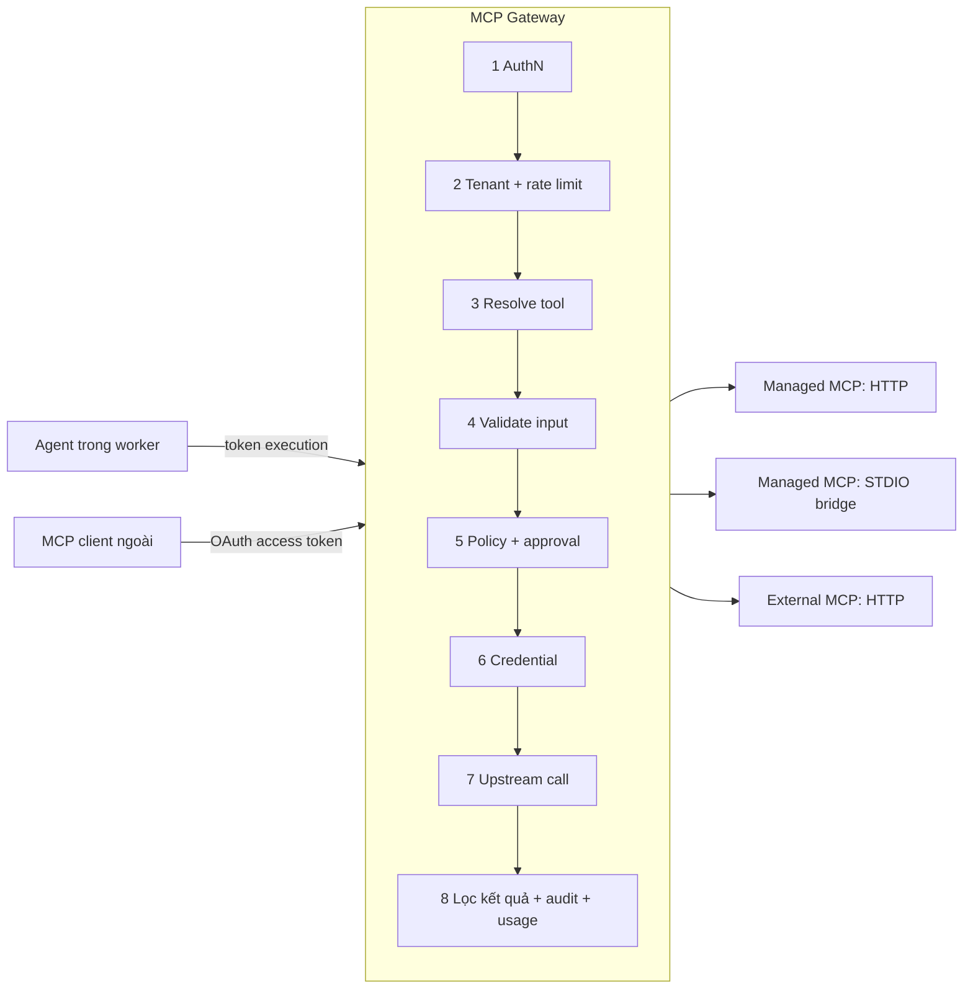

# MCP Platform: Gateway, Registry, Transport

Trạng thái: **Đề xuất** · Liên quan: [ADR-0004](../adr/0004-mcp-gateway-single-egress.md)

## 1. Căn cứ phiên bản

| Hạng mục | Lựa chọn | Ghi chú |
|---|---|---|
| SDK | `github.com/modelcontextprotocol/go-sdk` (dòng v1.x) | Đã có cam kết tương thích API từ v1.0. Tại thời điểm viết, bản mới nhất là v1.8.0 |
| Protocol mục tiêu | MCP `2026-07-28` | Phía Gateway phục vụ client |
| Protocol tương thích ngược | `2025-11-25`, `2025-06-18`, `2025-03-26` | Phía Gateway gọi upstream server cũ; SDK đã hỗ trợ thương lượng |

Bản `2026-07-28` thay đổi đáng kể so với các bản trước và ảnh hưởng trực tiếp tới thiết kế Gateway:

- **Stateless:** bỏ handshake `initialize` và header `Mcp-Session-Id`. Mọi request có thể rơi vào bất kỳ instance nào, nên Gateway scale ngang sau load balancer thường, không cần sticky session hay session store.
- **Header `Mcp-Method` và `Mcp-Name`** bắt buộc trên request Streamable HTTP. Gateway định tuyến, rate limit và kiểm tra quyền sơ bộ theo header, trước khi parse body.
- **Kết quả list có `ttlMs` và `cacheScope`:** Gateway cache `tools/list` theo đúng chỉ dẫn của server.
- **Authorization:** Dynamic Client Registration bị thay bằng Client ID Metadata Documents; client phải kiểm tra `iss` (RFC 9207).
- **Thông báo thay đổi** đi qua `subscriptions/listen` thay cho endpoint GET.

Hệ quả: không thiết kế bất kỳ thứ gì dựa trên session MCP. Trạng thái nhiều lượt (ví dụ chờ approval) thuộc về execution của platform, không thuộc về kết nối MCP.

> Các chi tiết trên cần được đối chiếu lại với đặc tả chính thức khi bắt đầu Phase 1; đặc tả MCP thay đổi nhanh và Gateway là nơi duy nhất trong hệ thống cần cập nhật theo.

## 2. Vai trò của Gateway

Gateway là **điểm thực thi chính sách** và **proxy**, không phải nơi chứa logic nghiệp vụ. Nó đồng thời là:

- **MCP server** đối với client (Agent nội bộ hoặc MCP client bên ngoài như IDE).
- **MCP client** đối với các upstream server (managed và external).



### Pipeline xử lý `tools/call`

| Bước | Việc làm | Thất bại → |
|---|---|---|
| 1. AuthN | Xác thực token; xác định principal (user, service account, hoặc execution) | 401 + `WWW-Authenticate` |
| 2. Tenant + rate limit | Gắn `org_id`, `project_id`; token bucket theo org, principal, tool | 429 |
| 3. Resolve | Tên tool → server + phiên bản tool đã duyệt. Tool không nằm trong tập được phép của principal thì **không tồn tại** đối với họ | Lỗi tool không tồn tại |
| 4. Validate | Kiểm tra arguments theo JSON Schema đã ghim; giới hạn kích thước | Lỗi invalid params |
| 5. Policy | `allow` / `deny` / `require_approval`, theo [security.md §4](security.md) | Lỗi có cấu trúc, kèm `approval_id` nếu cần duyệt |
| 6. Credential | Lấy credential của upstream cho đúng org / user từ Secrets | 5xx, không lộ chi tiết |
| 7. Upstream | Gọi với timeout, circuit breaker, propagate trace context | Lỗi upstream |
| 8. Hậu xử lý | Cắt kết quả theo ngưỡng, che secret, ghi audit và usage | — |

Bước 5 là nơi quyết định duy nhất về quyền gọi tool. Agent Runtime gọi cùng logic này (bước `AuthorizeToolCall`) để biết trước có cần approval hay không, nhưng Gateway **luôn kiểm tra lại**: Runtime bị lỗi hoặc bị vượt qua cũng không gọi được tool.

Hiện thực (Phase 2, chi tiết ở [security.md §4.5](security.md)): với lời gọi từ execution, bước 5 còn tạo / tiêu thụ approval và giữ chỗ `(task, step_seq)` trong `mcp_tool_claims` trước bước 7. Runtime gửi `hq/step_seq` trong `_meta`; Gateway gửi `hq/idempotency_key` xuống upstream và trả `hq/code` (`approval_required`, `approval_denied`, `denied`, `outcome_unknown`) cùng `hq/approval_id` về runtime. Client MCP bên ngoài chỉ gọi được tool `read`.

## 3. Endpoint

| Endpoint | Mục đích |
|---|---|
| `POST /mcp/v1/projects/{project}` | Server ảo tổng hợp: mọi tool mà principal được phép trong project, tên có namespace `server.tool` |
| `POST /mcp/v1/projects/{project}/servers/{server}` | Một server cụ thể, tên tool giữ nguyên |
| `GET /.well-known/oauth-protected-resource/...` | Protected Resource Metadata (RFC 9728) |

Endpoint MCP nằm trên process `gateway`, host riêng (ví dụ `mcp.<domain>`), tách hẳn REST management API trên `api.<domain>`.

Đối với Agent nội bộ, `tools/list` trả về đúng tập tool của Agent Version đang chạy (đã lọc theo cấu hình Agent ∩ quyền người khởi tạo). Việc lọc này cũng là tối ưu chi phí: model không nhận mô tả của những tool nó không được dùng.

## 4. Xác thực

### 4.1 Client → Gateway

| Principal | Cơ chế |
|---|---|
| MCP client bên ngoài (người dùng) | OAuth 2.1 Authorization Code + PKCE với IdP của platform. Gateway là resource server, kiểm tra `aud` đúng là chính nó (RFC 8707) |
| Service / CI | Client credentials hoặc API key phạm vi project |
| Agent nội bộ | **Execution token**: JWT ngắn hạn do platform ký, claim gồm `org`, `project`, `execution_id`, `task_id`, `agent_version_id`, `initiator`. Hết hạn theo deadline của task |

### 4.2 Gateway → Upstream

**Không chuyển tiếp token của client xuống upstream.** Gateway dùng credential riêng cho từng upstream:

| Loại upstream | Credential |
|---|---|
| Managed server | Token dịch vụ nội bộ (mTLS hoặc JWT), kèm header ngữ cảnh đã ký: org, project, initiator, execution |
| External, credential dùng chung của org | Secret của org lưu trong Secrets, giải mã lúc gọi |
| External, uỷ quyền theo user | OAuth token của từng user với server đó, lưu mã hoá, refresh tự động. Thiếu token → trả lỗi yêu cầu liên kết tài khoản |

## 5. Registry

### 5.1 Mô hình

- `mcp_servers`: định danh, chủ sở hữu (org hoặc platform), transport, endpoint, phương thức xác thực, trạng thái.
- `mcp_server_versions`: ảnh chụp bất biến kết quả discovery (tools, resources, prompts) kèm hash.
- `mcp_tools`: mỗi tool của version đang hoạt động, kèm thuộc tính chính sách do platform quản lý.

Resources và prompts được lưu trong ảnh chụp của version (JSONB), chưa tách bảng. Lý do và điều kiện tách: xem [schema.md §4](../database/schema.md).

### 5.2 Thuộc tính chính sách của tool

| Thuộc tính | Giá trị | Nguồn |
|---|---|---|
| `risk_level` | `read`, `write`, `destructive`, `financial` | Admin gán. Annotation của server (`readOnlyHint`, `destructiveHint`) chỉ dùng làm gợi ý ban đầu |
| `side_effect` | `none`, `idempotent`, `non_idempotent` | Admin gán |
| `default_approval` | `never`, `always`, `policy` | Suy ra từ `risk_level`, có thể ghi đè chặt hơn |
| `max_result_bytes`, `timeout` | Số | Mặc định theo server |
| `unit_cost` | Tuỳ chọn | Cho tool gọi dịch vụ tính phí |

Tool mới phát hiện mặc định `risk_level = destructive` và `enabled = false` cho tới khi admin phân loại. Mặc định an toàn quan trọng hơn tiện lợi.

### 5.3 Discovery và ghim định nghĩa tool

1. Khi đăng ký hoặc theo lịch, Registry gọi `tools/list` (và resources, prompts).
2. Tính hash trên `name + description + inputSchema` của từng tool.
3. Không đổi → cập nhật `last_seen_at`.
4. Có thay đổi → tạo `mcp_server_version` mới ở trạng thái `pending_review`. Version đang hoạt động vẫn phục vụ; tool có mô tả hoặc schema thay đổi **bị tạm khoá** cho tới khi duyệt.

Bước 4 chống kiểu tấn công "đổi mô tả tool sau khi đã được tin" (mô tả tool được đưa vào prompt nên là một kênh tiêm lệnh). Với managed server do chính mình deploy, có thể bật tự duyệt theo pipeline CI.

### 5.4 Health và lifecycle

```
REGISTERED → ACTIVE ⇄ DEGRADED → UNREACHABLE
     │          │
     └──────────┴──▶ DISABLED → ARCHIVED
```

- Health check định kỳ bằng một lời gọi rẻ. `DEGRADED` sau N lần lỗi liên tiếp hoặc tỉ lệ lỗi vượt ngưỡng; `UNREACHABLE` mở circuit breaker.
- Trạng thái health là dữ liệu vận hành, lưu ở Redis và phản chiếu định kỳ vào Postgres; không dùng làm điều kiện phân quyền.

## 6. Transport

### 6.1 Streamable HTTP

Mặc định cho mọi server từ xa. Mọi endpoint do người dùng đăng ký đều qua kiểm tra chống SSRF ([security.md §6](security.md)) ở cả lúc đăng ký và **mỗi lần gọi**.

### 6.2 STDIO Bridge

Server STDIO là một process cục bộ, một client mỗi process. Bridge biến nó thành upstream HTTP nội bộ:

- Mỗi server STDIO chạy trong container riêng, do bridge quản lý vòng đời (khởi động theo nhu cầu, tắt khi rảnh, khởi động lại khi chết).
- Cách ly: một process cho mỗi cặp (server, org). Không dùng chung process giữa các tenant.
- Container: không quyền root, filesystem chỉ đọc, giới hạn CPU / RAM, network mặc định đóng, chỉ mở egress tới đích khai báo.
- **Chỉ platform admin được đăng ký server STDIO**, từ image đã được duyệt. Đăng ký STDIO tương đương cấp quyền chạy code trên hạ tầng của platform; không mở cho tenant.

Đề xuất ưu tiên: integration tự viết dùng Streamable HTTP. STDIO bridge chỉ để tái sử dụng server cộng đồng có sẵn, và đưa vào ở Phase 4, không phải Phase 1.

### 6.3 Managed và External

| | Managed | External |
|---|---|---|
| Ai vận hành | Platform (code trong `internal/integration/*`) | Bên thứ ba hoặc tenant |
| Tin cậy định nghĩa tool | Cao, tự duyệt qua CI | Thấp, duyệt thủ công mỗi thay đổi |
| Tin cậy kết quả tool | Dữ liệu không tin cậy (vẫn có thể chứa nội dung do bên ngoài kiểm soát) | Dữ liệu không tin cậy |
| Idempotency key | Bắt buộc hỗ trợ | Không đảm bảo |
| Ngữ cảnh tenant | Header đã ký | Chỉ qua credential |

## 7. Chuẩn cho managed MCP server (integration)

Mỗi integration là một MCP server độc lập, tuân theo một khuôn chung:

- Tool nhỏ, một việc, schema chặt (`additionalProperties: false`, enum thay cho chuỗi tự do khi có thể).
- Tách tool đọc và tool ghi; không có tool "chạy lệnh bất kỳ" (không `exec`, không SQL tự do trên production). Ví dụ Database Agent có `explain_query`, `list_slow_queries`, `run_readonly_query` (trên replica, có `statement_timeout` và giới hạn dòng), không có `run_sql`.
- Tool ghi nhận `idempotency_key`; hỗ trợ `dry_run` khi hệ thống đích cho phép, để approval hiển thị được tác động dự kiến.
- Kết quả có cấu trúc, phân trang, giới hạn kích thước.
- Credential của hệ thống đích do server lấy theo ngữ cảnh tenant, không nhận qua tham số tool.
- Bộ test hợp đồng dùng chung chạy trong CI cho mọi integration.

**Handler dùng chung (`internal/integration/serve`).** Mọi integration dựng HTTP handler của mình bằng `serve.Handler(slug, signer, orgID, newServer)`: kiểm chữ ký ngữ cảnh của Gateway, gắn server với đúng một org, và giới hạn ngữ cảnh discovery ở việc liệt kê tool. Luật discovery được thực thi bằng một `mcp.Server` riêng có middleware chạy *bên trong* MCP SDK, trên method mà chính SDK đã đọc ra. Bản đầu (chép giữa `docker` và `prometheus`) tự đọc `method` trong body bằng `encoding/json` rồi mới chuyển cho SDK; hai trình đọc hiểu một body có thêm khoá `"Method"` theo hai cách, nên ngữ cảnh discovery gọi được tool mà không qua policy, audit hay rate limit của Gateway. Bài học thành luật: integration không phân quyền bằng cách tự phân tích body, và không chép đoạn kiểm ngữ cảnh. Bộ test hợp đồng có ca cho đúng kiểu body này.

**Ghi chú hiện thực (Phase 4, đợt 4a).** Bộ test hợp đồng là `internal/integration/contract`: mỗi integration gọi `contract.Run(t, contract.Server{…})` trong test của nó, trên một hệ thống đích giả lập. Đây là package test; luật depguard `no-integration-contract-in-prod` cấm code sản phẩm import nó. Năm integration đang chạy qua bộ test: `docker`, `prometheus`, `loki`, `kubernetes`, `github` (runbook: [prometheus](../runbooks/integration-prometheus.md), [loki](../runbooks/integration-loki.md), [kubernetes](../runbooks/integration-kubernetes.md), [github](../runbooks/integration-github.md)). Prometheus, Loki và Kubernetes còn có test đầu-cuối với hệ thống thật trong container, đi qua Gateway (`tests/api/*_e2e_test.go`; Kubernetes cần `HQ_TEST_K3S=1`). GitHub chưa chạy với GitHub thật.

**Đổi địa chỉ của managed server.** `hqadmin mcp-server set-endpoint -slug <slug> -org <org> -endpoint <url>` (migration 00037, 00038). Discovery ở địa chỉ mới KHÔNG chứng minh đó là đúng server (chữ ký ngữ cảnh chỉ xác thực request của platform; host nào trả đúng danh sách tool cũng qua): người vận hành chịu trách nhiệm về địa chỉ, như khi đăng ký. Lệnh bảo đảm: chỉ managed server của một organization (server phạm vi platform bị từ chối cho tới khi có audit cấp platform); `https`, trừ khi `HQ_ENV` được đặt tường minh là `local`; định nghĩa tool ở địa chỉ mới đi qua luật của discovery (có đổi: version chờ duyệt, tool bị khoá); audit `mcp_server.set_endpoint` ghi địa chỉ cũ và mới. Trigger của `mcp_servers` (00038) từ chối đổi `endpoint` của server không phải `managed` với mọi role. Còn nợ: đổi host mà định nghĩa không đổi thì không cần ai duyệt; kết hợp với việc ngữ cảnh ký chưa gắn body và dùng khoá chung, một địa chỉ sai nhận được ngữ cảnh ký phát lại được trong 2 phút.

**Tên trường và lớp che của Gateway.** Gateway che GIÁ TRỊ của mọi trường JSON có tên khớp `password|passwd|pwd|secret|token|api_key|access_key|private_key|credential` trong kết quả tool. Một trường hợp pháp mang tên như vậy tới model ở dạng `[REDACTED:secret_field]`: con trỏ phân trang `next_page_token` của Kubernetes đã hỏng đúng theo cách đó (review tìm ra, test đầu-cuối xác nhận sau khi sửa). Bộ test hợp đồng nay từ chối các tên này ở cả input lẫn output schema; con trỏ phân trang tên `cursor` / `next_cursor`.

**Giới hạn theo truy vấn.** Trần của tool không được chỉ nằm ở tham số: Loki ban đầu chỉ kiểm `start` / `end`, và một biểu thức LogQL mang cửa sổ `[30d]` hoặc `offset` đọc được nội dung log cũ qua label dù khoảng thời gian hợp lệ (đã chứng minh trên Loki thật). Integration nhận ngôn ngữ truy vấn phải kiểm cả biểu thức (Loki: bộ kiểm từ vựng, fail-closed) VÀ yêu cầu giới hạn phía hệ thống đích trong runbook.

Bộ test nói chuyện với server qua MCP Streamable HTTP kèm ngữ cảnh ký, như Gateway, và kiểm:

| Điều chuẩn | Cách kiểm |
|---|---|
| Chỉ nhận ngữ cảnh do Gateway ký | Thiếu header, rác, khoá khác, đích (`aud`) khác, hết hạn, nội dung bị sửa sau khi ký, mất chữ ký → 401 / 403, không request nào tới hệ thống đích, phản hồi không lộ tên tool |
| Ngữ cảnh discovery chỉ liệt kê tool | `tools/list` chạy được; `tools/call` (qua SDK, thông điệp thô và batch) bị từ chối, không chạm hệ thống đích |
| Server gắn một org | Tool call có chữ ký hợp lệ của org khác bị từ chối, không chạm hệ thống đích |
| Định nghĩa tool | Tập tool công bố khớp tập đã khai; tên `snake_case` dạng động từ + danh từ, không chứa `exec` / `shell` / `sql` / `command`…; có mô tả, không quá 1024 byte; input schema là object, mọi nút object có `additionalProperties: false`; tên trường `snake_case` |
| Không nhận credential, lệnh, SQL tự do, đích tự chọn | Danh sách tên trường cấm (`password`, `token`, `api_key`, `command`, `script`, `sql`, `url`, `headers`… và các hậu tố tương ứng). Là heuristic theo tên |
| Tách đọc / ghi | Tool đọc mang `readOnlyHint` và không có `idempotency_key` / `dry_run`; tool ghi không mang `readOnlyHint` |
| Giới hạn đầu vào | Arguments có trường lạ, và chuỗi 256 KiB ở mỗi tham số chuỗi không có enum, bị từ chối trước khi tới hệ thống đích |
| Giới hạn kết quả | Mỗi bộ arguments mẫu chạy được, trả `structuredContent`, và kết quả không vượt `MaxResultBytes` đã khai (đo phần văn bản như Gateway đo, và phần có cấu trúc) |
| Tool ghi | Có `idempotency_key` (chuỗi, bắt buộc) và `dry_run` (boolean; hoặc khai lý do không hỗ trợ); gọi hai lần cùng `idempotency_key` gây đúng một tác động; `dry_run` không gây tác động |

Chưa kiểm được tự động, vẫn cần người review: tool có thật sự "một việc" và mô tả có trung thực không; một trường mang tên vô hại nhưng nhận lệnh hay credential; credential có lọt vào kết quả hoặc log không (mỗi integration tự test với dữ liệu giả lập của nó); cách ly tenant của server phục vụ nhiều org; phân trang có đi hết được không; kết quả lớn nhất mà hệ thống đích THẬT trả được (bộ test chỉ thấy mẫu của hệ thống giả lập); phân loại rủi ro đề xuất có đúng không. Phần kiểm tool ghi mới chỉ chạy trên server mẫu trong test của chính package `contract`: chưa integration nào có tool ghi.

Điểm lệch đã biết: `max_result_bytes` trong Registry mặc định 64 KiB và chưa sửa được qua `hqadmin` hay API, trong khi `get_container_logs` của `docker` trả tới 256 KiB log thô (kết quả tuần tự hoá còn lớn hơn). Gateway sẽ cắt phần vượt, giữa chừng JSON. Integration `prometheus` tự giữ mọi kết quả dưới 64 KiB vì lý do này.

## 8. Quan sát và audit

- Một span cho mỗi tool call tại Gateway, là con của span step trong worker, là cha của span trong managed server.
- Metric theo `server`, `tool`, `org`, `outcome`: số lượng, độ trễ, kích thước kết quả, tỉ lệ deny và require-approval.
- Audit ghi: principal, execution, tool, hash của arguments, quyết định policy, approval liên quan, kết quả (thành công / lỗi), thời lượng. Arguments đầy đủ lưu ở `execution_steps` với thời hạn giữ ngắn hơn và có che trường nhạy cảm theo schema.
