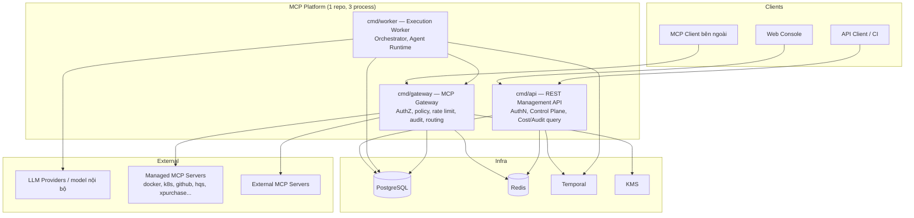
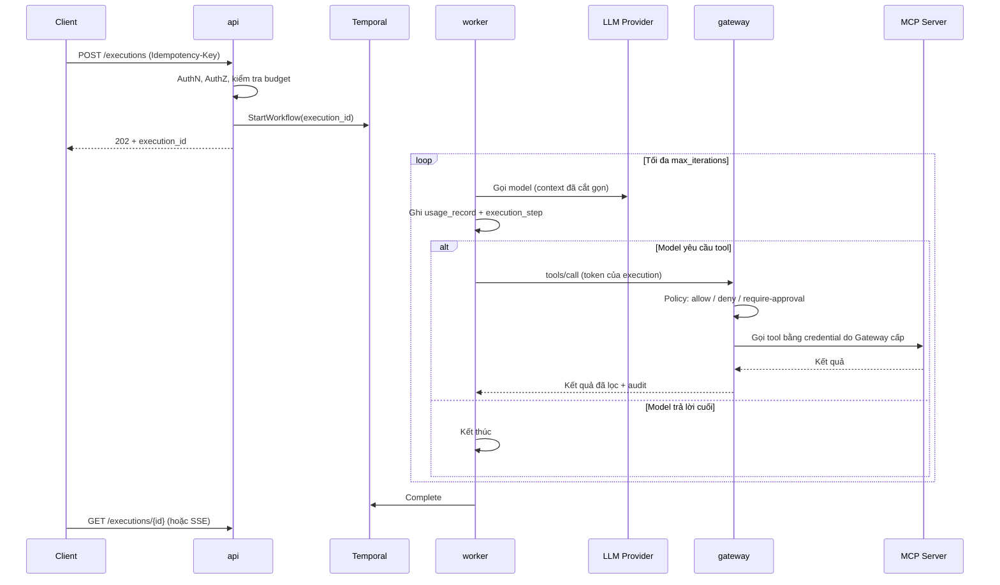

# MCP Platform — Tổng quan kiến trúc

Trạng thái: **Đề xuất, chờ xác nhận** · Phiên bản 0.1 · 2026-11-17

Tài liệu này là điểm vào của bộ thiết kế. Chi tiết nằm ở các tài liệu con:

| Tài liệu | Nội dung |
|---|---|
| [agent-runtime.md](agent-runtime.md) | Vòng lặp Agent, Orchestrator, multi-agent, context |
| [mcp-platform.md](mcp-platform.md) | MCP Gateway, Registry, transport, STDIO bridge |
| [security.md](security.md) | Threat model, AuthN/AuthZ, approval, secrets |
| [cost-management.md](cost-management.md) | Usage ledger, pricing, budget, model router |
| [../database/schema.md](../database/schema.md) | PostgreSQL schema |
| [../api/openapi.yaml](../api/openapi.yaml) | REST management API |
| [../roadmap.md](../roadmap.md) | Phase, tiêu chí hoàn thành, rủi ro |
| [../adr/](../adr/README.md) | Các quyết định kiến trúc |

---

## 1. Phạm vi và nguyên tắc

MCP Platform là nền tảng chạy và quản trị nhiều AI Agent, trong đó mọi hành động lên hệ thống thật đều đi qua MCP Tool có kiểm soát quyền, có audit và có tính chi phí.

Năm nguyên tắc dùng để phân xử khi các yêu cầu mâu thuẫn nhau:

1. **Deterministic trước, LLM sau.** Việc gì code hoặc API giải quyết được thì không gọi LLM. LLM chỉ dùng cho phần cần suy luận.
2. **LLM đề xuất, platform quyết định.** Model không bao giờ là nơi thực thi quyền. Mọi tool call đều bị policy engine kiểm tra bên ngoài model.
3. **Một đường duy nhất tới thế giới bên ngoài.** Agent không giữ credential, không gọi thẳng hệ thống nghiệp vụ; chỉ gọi qua MCP Gateway.
4. **Ghi trước, tối ưu sau.** Usage, audit và execution step được ghi từ Phase 1 vì không thể backfill. Dashboard, forecast, router thông minh làm sau.
5. **Thêm hạ tầng khi có bằng chứng cần.** Mỗi thành phần hạ tầng mới phải có ADR nêu rõ vấn đề mà các thành phần hiện có không giải quyết được.

## 2. Bounded contexts

| Context | Trách nhiệm | Sở hữu dữ liệu | Phụ thuộc vào |
|---|---|---|---|
| **Identity & Tenancy** | Organization, project, user, membership, API key | organizations, projects, users, memberships, api_keys | — |
| **Authorization & Policy** | RBAC + điều kiện thuộc tính, phân loại rủi ro, quyết định allow / deny / require-approval | roles, permissions, role_bindings | Identity |
| **Agent Catalog** | Định nghĩa Agent và version bất biến | agents, agent_versions | Identity, Model Catalog, MCP Catalog |
| **Execution** | Session, execution, task, step, memory; vòng lặp Agent; Orchestrator | agent_sessions, agent_executions, agent_tasks, execution_steps, execution_plan_steps, agent_memory | Agent Catalog, Policy, MCP Gateway, AI Provider, Cost |
| **MCP Platform** | Registry, discovery, health, Gateway, transport | mcp_servers, mcp_server_versions, mcp_tools | Identity, Policy, Secrets |
| **Workflow** | Workflow do người dùng định nghĩa, lịch chạy, approval | workflows, workflow_executions, approvals | Execution, Policy |
| **AI Provider** | Adapter provider, model catalog, prompt version | model_providers, models | Secrets |
| **Cost** | Usage ledger, pricing, budget, đối soát | model_pricing, usage_records, cost_records, budgets | AI Provider |
| **Secrets** | Mã hoá, xoay vòng, cấp credential ngắn hạn | secrets_metadata | KMS |
| **Audit & Observability** | Audit trail bất biến, trace, metric, log | audit_logs | — (mọi context ghi vào) |

Quy tắc phụ thuộc trong code: context chỉ gọi nhau qua interface Go khai báo ở phía **bên dùng**; không import package `internal/.../store` của context khác; không join SQL xuyên context ngoài các truy vấn báo cáo của Cost và Audit. Quy tắc này được kiểm bằng linter (`depguard`) trong CI, vì đây là điều kiện để sau này tách service mà không phải viết lại.

## 3. Sơ đồ thành phần



### Ba process, một codebase

| Process | Vai trò | Stateless? | Scale theo |
|---|---|---|---|
| `api` | REST management, khởi tạo execution, truy vấn; nhận lần lịch kích hoạt của workflow từ Temporal trên task queue `api-internal` và tạo lần chạy ([ADR-0015](../adr/0015-workflows-compile-to-planned-executions.md)) | Có | Số request quản trị |
| `gateway` | Endpoint MCP cho client ngoài và cho Agent nội bộ | Có | Số tool call |
| `worker` | Chạy Temporal workflow và activity của execution trên task queue `agent-shared`: vòng lặp Agent, kế hoạch (kể cả lần chạy của workflow người dùng), gọi LLM, gọi tool. Không tạo được execution hay task của kế hoạch | Có (state nằm ở Temporal + Postgres) | Số execution đồng thời |

Lý do tách `gateway` khỏi `api` ngay từ đầu dù vẫn là modular monolith: hai process có bề mặt tấn công, hồ sơ tải và chu kỳ deploy khác nhau. Gateway nhận traffic từ MCP client không tin cậy và giữ quyền truy cập credential; API thì không cần quyền đó.

**Điều chỉnh so với cấu trúc tham khảo:** bỏ `cmd/scheduler`. Lịch chạy dùng Temporal Schedules, không cần thêm một process tự viết phải lo leader election. Xem [ADR-0002](../adr/0002-temporal-durable-execution.md).

## 4. Luồng chính

### 4.1 Một execution đơn Agent



### 4.2 Đường tắt không LLM

Khi request chỉ định rõ tool và tham số (ví dụ gọi từ CI: "restart service X"), API tạo execution kiểu `direct_tool`: bỏ qua vòng lặp Agent, vẫn đi qua policy, approval, audit. Đây là cách hiện thực hoá nguyên tắc 1 mà không tạo ra đường vòng tránh kiểm soát.

### 4.3 Multi-agent

Mô tả ở [agent-runtime.md §5](agent-runtime.md). Tóm tắt: Orchestrator là một Temporal workflow cha; mỗi Agent task là một child workflow; delegation là một lời gọi tới Orchestrator chứ không phải Agent gọi thẳng Agent.

## 5. Hạ tầng: dùng gì, khi nào

| Thành phần | Quyết định | Từ phase |
|---|---|---|
| PostgreSQL | Nguồn sự thật duy nhất cho dữ liệu nghiệp vụ | 1 |
| Redis | Rate limit, bộ đếm budget tức thời, cache discovery. **Không** chứa dữ liệu không tái tạo được | 1 |
| Temporal | Durable execution cho Agent loop, Orchestrator, workflow, approval, schedule | 2 (kéo sớm so với đề bài, xem ADR-0002) |
| NATS JetStream | **Hoãn.** Chưa có nhu cầu mà Temporal + transactional outbox trên Postgres không đáp ứng | Khi có bằng chứng (ADR-0003) |
| Kubernetes | Chỉ cần khi chạy isolated runtime hoặc HA nhiều node. Phase 1–3 chạy được bằng Docker Compose / một VM | 4–6 |
| OpenTelemetry + Prometheus + Grafana + Loki | Trace xuyên api → worker → gateway → MCP server từ Phase 1 | 1 |
| KMS | Envelope encryption cho secret (ADR-0008) | 1 |

## 6. Multi-tenancy

- Mô hình: shared database, shared schema, cột `org_id` trên mọi bảng thuộc tenant, cộng Row-Level Security làm lớp phòng thủ thứ hai ([ADR-0005](../adr/0005-tenant-isolation-rls.md)).
- Phân cấp: Organization → Project → tài nguyên (agent, MCP server binding, workflow). Budget và quyền gắn được ở cả hai cấp.
- Tenant context được xác lập đúng một lần ở middleware, truyền qua `context.Context`, và được gắn vào mọi span, log, audit record, Temporal workflow ID và search attribute (`OrgId`, `ProjectId`).
- Tenant lớn hoặc yêu cầu tuân thủ cao: lối thoát là isolated runtime (task queue + namespace riêng), chưa phải database riêng.

## 7. Yêu cầu phi chức năng — cách đạt được

| Yêu cầu | Cơ chế |
|---|---|
| Fault tolerance, phục hồi sau restart | State execution nằm trong Temporal; activity idempotent theo `step_id` |
| Idempotent execution | `Idempotency-Key` ở REST; `idempotency_key = execution_id + step_seq` cho tool call có side effect |
| Cancellation | Huỷ workflow cha lan xuống child workflow và `context.Context` của activity; LLM stream và tool call bị ngắt |
| Backpressure | Giới hạn concurrency theo org, task queue riêng theo mức ưu tiên, 429 kèm `Retry-After` ở API và Gateway. Hiện thực Phase 2: trần theo org tính bằng số vòng lặp Agent chạy đồng thời (execution `planned` chiếm số task nó chạy song song), được đếm trong database lúc tạo execution (dưới advisory lock theo org), trần của process là số activity đồng thời của worker, một task queue `agent-shared`; semaphore ở worker và task queue theo ưu tiên chưa làm |
| Graceful shutdown | `api`/`gateway`: ngừng nhận, drain theo deadline. `worker`: ngừng poll, hoàn tất hoặc heartbeat-timeout activity để Temporal giao lại |
| Resource limits | Giới hạn theo execution: iterations, tool calls, wall-clock, token, chi phí, kích thước kết quả tool |
| Retry with backoff | Retry policy khai báo theo loại activity; lỗi phân loại retryable / non-retryable; không retry tool không idempotent |
| Observability | `trace_id` = xuyên suốt; `execution_id`, `org_id`, `agent_id` là attribute chuẩn trên span, log, metric |

**Không cam kết SLA hay throughput ở giai đoạn này.** Kế hoạch đo nằm ở [roadmap.md §Phase 6](../roadmap.md): xác định điểm bão hoà của từng process bằng load test với LLM và MCP server giả lập có độ trễ thực tế, rồi mới đặt SLO.

## 8. Cấu trúc source code (đã điều chỉnh)

```
cmd/
  api/  gateway/  worker/
internal/
  platform/      identity/ tenancy/ authz/ secrets/ config/
  agent/         catalog/ runtime/ (runtime/durable: vòng lặp trên Temporal) orchestrator/ memory/
  mcp/           gateway/ registry/ transport/ client/
  workflow/      definitions/ (definitions/schedule: lịch chạy trên Temporal Schedules) approval/ notify/ (webhook thông báo: cấu hình ở api, bộ gửi ở gateway)
  webui/         phục vụ giao diện web ở /ui/ (bởi api) từ bản build nhúng bằng go:embed (dist/); không có quyền riêng
  ai/            provider/ modelcatalog/ router/ prompt/
  cost/          ledger/ pricing/ budget/ reconcile/
  integration/   <mỗi MCP server managed một thư mục>
  audit/  observability/
  shared/        ids/ errors/ httpx/ pgx/
  apiserver/ gatewayserver/ workerserver/   composition root của từng process
  runtimewire/   dựng các bước của Agent Runtime; dùng chung bởi workerserver và apiserver (chế độ local)
  adminops/      đường code xuyên tenant của công cụ quản trị
web/             mã nguồn giao diện web (React + TypeScript, Vite; ADR-0016); build vào internal/webui/dist
  src/
    app/         khung ứng dụng: bảng route (nơi duy nhất biết mọi feature), khung trang, màn hình đăng nhập
    api/         chỗ duy nhất gọi Management API; kiểu sinh từ openapi.yaml (schema.gen.ts)
    auth/        đăng nhập OIDC (PKCE), phiên
    i18n/        từ điển vi / en cùng bộ khoá
    components/  thành phần trình bày dùng chung
    lib/         tầng thấp nhất, không gọi mạng: định dạng, visible(), quy tắc hiển thị approval, lựa chọn hiển thị trong sessionStorage
    features/    mỗi màn hình một thư mục (overview, projects, agents, executions, approvals, workflows, cost, mcp, audit); feature không import lẫn nhau
migrations/  deployments/  scripts/  tests/  .docs/
```

Khác biệt so với bản tham khảo và lý do:

- `cost/` tách khỏi `ai/` vì đề bài yêu cầu Cost Management độc lập, và cost còn tính cả MCP tool, không chỉ token.
- `planner/` gộp vào `orchestrator/` (hiện `orchestrator/` chỉ chứa phần thuần: kiểu kế hoạch, kiểm, bộ lập lịch, cấu hình; phần có I/O của `mode: planned` nằm trong `runtime/`, xem [agent-runtime §5.8](agent-runtime.md)); `modelrouter/` chuyển sang `ai/router/` vì router không biết gì về Agent.
- `policy/` gộp vào `platform/authz/`: một điểm quyết định quyền duy nhất.
- `mcp/discovery` gộp vào `mcp/registry`; `mcp/server` chuyển thành `integration/*` vì mỗi integration là một MCP server.
- Bỏ `cmd/scheduler`.

## 9. Các điểm cần xác nhận trước khi viết code

1. Kéo Temporal lên Phase 2 thay vì Phase 3 (ADR-0002).
2. Hoãn NATS JetStream (ADR-0003).
3. Tách lifecycle của Agent definition khỏi lifecycle của execution (ADR-0006).
4. Identity Provider: tự vận hành (Keycloak / Zitadel) hay dùng dịch vụ có sẵn. Thiết kế chỉ yêu cầu OIDC chuẩn nên quyết định này không chặn Phase 1.
5. KMS: GCP KMS (vì GCP đã có trong danh sách integration) hay giải pháp khác.
6. Thứ tự ưu tiên integration ở Phase 4: đề xuất DevOps (Docker, Kubernetes, GitHub) trước, hệ thống tài chính (HQS, X-Purchase, thanh toán) sau cùng vì rủi ro cao nhất.
