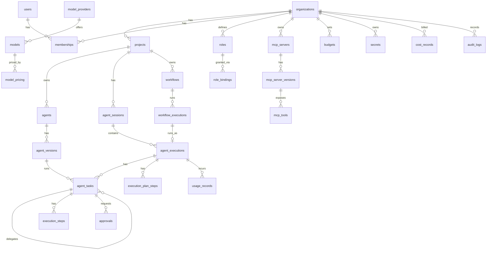

# PostgreSQL Schema

Trạng thái: **Đề xuất** · Liên quan: [ADR-0005](../adr/0005-tenant-isolation-rls.md), [ADR-0006](../adr/0006-agent-definition-vs-execution-lifecycle.md), [ADR-0007](../adr/0007-usage-ledger-from-phase-1.md)

DDL dưới đây là thiết kế, chưa phải migration cuối cùng: đủ để xem xét quan hệ, khoá và index. Migration thật được viết theo từng phase.

## 1. Quy ước chung

| Quy ước | Lựa chọn | Lý do |
|---|---|---|
| Khoá chính | `UUID` phiên bản 7 | Sắp xếp theo thời gian nên index B-tree ít phân mảnh; kiểu `uuid` gốc 16 byte; không lộ số lượng bản ghi. Dùng `uuidv7()` của PostgreSQL 18, hoặc sinh ở ứng dụng với bản cũ hơn |
| Thời gian | `TIMESTAMPTZ`, UTC | `created_at` mọi bảng; `updated_at` cho bảng sửa được |
| Tenant | Cột `org_id` trên mọi bảng thuộc tenant, kể cả khi suy ra được qua khoá ngoại | Cần cho RLS và cho index bắt đầu bằng `org_id` |
| Trạng thái | `TEXT` + `CHECK` | Thêm giá trị không cần `ALTER TYPE` như enum |
| Xoá | Xoá mềm (`archived_at`) cho tài nguyên cấu hình; dữ liệu thực thi xoá theo retention | |
| Tiền | `NUMERIC(18,8)` + `currency CHAR(3)` | Không dùng float |
| JSONB | Chỉ cho dữ liệu có cấu trúc thay đổi theo loại (config, snapshot). Trường dùng để lọc hoặc join là cột thật | |
| Truy cập | `pgx` + `sqlc` | SQL tường minh, kiểm tra kiểu lúc build |

## 2. So với danh sách bảng trong đề bài

| Bảng đề bài | Quyết định | Lý do |
|---|---|---|
| organizations, users, projects | Giữ | |
| agents, agent_versions | Giữ | Agent là định danh; version bất biến |
| agent_sessions, agent_executions, agent_tasks, agent_memory | Giữ | Ba cấp có ý nghĩa khác nhau, xem [agent-runtime §1](../architecture/agent-runtime.md) |
| mcp_servers, mcp_server_versions, mcp_tools | Giữ | |
| **mcp_resources, mcp_prompts** | **Gộp vào `mcp_server_versions.snapshot`** | Chưa có chính sách, quyền hay chi phí nào gắn vào từng resource / prompt. Tách bảng khi cần phân quyền ở mức đó |
| model_providers, models, model_pricing | Giữ | |
| workflows, workflow_executions | Giữ | `workflow_executions` là bản chiếu để truy vấn; Temporal giữ lịch sử chi tiết |
| approvals | Giữ | |
| roles | Giữ | |
| **permissions** | **Không tạo bảng** | Danh mục permission là hằng số trong code (thêm permission luôn cần thay đổi code kiểm tra nó). Role lưu `permissions TEXT[]` |
| secrets_metadata | Giữ, đổi tên `secrets` | Chứa cả ciphertext do dùng envelope encryption trong Postgres (ADR-0008) |
| usage_records, cost_records | Giữ, ý nghĩa tách bạch | `usage_records` = từng lời gọi + ước tính; `cost_records` = chi phí thực từ provider |
| audit_logs | Giữ | |

Bảng bổ sung, mỗi bảng có lý do bắt buộc:

| Bảng thêm | Lý do |
|---|---|
| `memberships` | User thuộc nhiều org |
| `role_bindings` | Gắn role cho principal theo phạm vi; không có thì RBAC không hoạt động |
| `api_keys` | Xác thực máy |
| `execution_steps` | Nhật ký từng lần gọi LLM / tool: cần cho phục hồi, idempotency, debug và audit |
| `budgets` | Yêu cầu Budget Management |
| `idempotency_keys` | Yêu cầu idempotency ở API |
| `outbox` | Phát sự kiện tin cậy không cần message broker (ADR-0003) |

Tổng cộng 36 bảng (thêm `mcp_execution_sensitive_reads` và `mcp_server_projects` ở 00040 / 00041 cho kiểm soát luồng dữ liệu và chính sách project; trước đó 34 bảng: thêm `execution_delegation_sources`, `execution_delegation_targets` cho delegation và `plan_proposals` cho đề xuất kế hoạch, Agent Runtime sở hữu). Trước đó 31 bảng: thêm `mcp_tool_claims` (Phase 2, MCP Gateway sở hữu) để một tool có tác dụng phụ không chạy hai lần cho cùng một bước của task.

## 3. Sơ đồ quan hệ



## 4. Định nghĩa bảng

### 4.1 Identity và tenancy

```sql
CREATE TABLE organizations (
  id          UUID PRIMARY KEY DEFAULT uuidv7(),
  slug        TEXT NOT NULL UNIQUE,
  name        TEXT NOT NULL,
  status      TEXT NOT NULL DEFAULT 'active' CHECK (status IN ('active','suspended','archived')),
  settings    JSONB NOT NULL DEFAULT '{}',   -- provider được phép, mặc định retention...
  created_at  TIMESTAMPTZ NOT NULL DEFAULT now(),
  updated_at  TIMESTAMPTZ NOT NULL DEFAULT now()
);

CREATE TABLE users (                          -- toàn cục, không thuộc tenant
  id           UUID PRIMARY KEY DEFAULT uuidv7(),
  idp_issuer   TEXT NOT NULL,
  idp_subject  TEXT NOT NULL,
  email        TEXT NOT NULL,
  display_name TEXT,
  status       TEXT NOT NULL DEFAULT 'active' CHECK (status IN ('active','disabled')),
  created_at   TIMESTAMPTZ NOT NULL DEFAULT now(),
  updated_at   TIMESTAMPTZ NOT NULL DEFAULT now(),
  UNIQUE (idp_issuer, idp_subject)
);

CREATE TABLE memberships (
  org_id     UUID NOT NULL REFERENCES organizations(id),
  user_id    UUID NOT NULL REFERENCES users(id),
  status     TEXT NOT NULL DEFAULT 'active' CHECK (status IN ('invited','active','removed')),
  created_at TIMESTAMPTZ NOT NULL DEFAULT now(),
  PRIMARY KEY (org_id, user_id)
);
CREATE INDEX memberships_user_idx ON memberships (user_id);

CREATE TABLE projects (
  id          UUID PRIMARY KEY DEFAULT uuidv7(),
  org_id      UUID NOT NULL REFERENCES organizations(id),
  slug        TEXT NOT NULL,
  name        TEXT NOT NULL,
  environment TEXT NOT NULL DEFAULT 'non_prod' CHECK (environment IN ('prod','non_prod')),
  settings    JSONB NOT NULL DEFAULT '{}',   -- giới hạn execution, chế độ planned...
  archived_at TIMESTAMPTZ,
  created_at  TIMESTAMPTZ NOT NULL DEFAULT now(),
  updated_at  TIMESTAMPTZ NOT NULL DEFAULT now(),
  UNIQUE (org_id, slug),
  UNIQUE (org_id, id)                        -- đích cho khoá ngoại ghép
);
CREATE INDEX projects_org_created_idx ON projects (org_id, created_at DESC, id DESC);
CREATE INDEX projects_org_name_idx    ON projects (org_id, name, id);

CREATE TABLE api_keys (
  id           UUID PRIMARY KEY DEFAULT uuidv7(),
  org_id       UUID NOT NULL REFERENCES organizations(id),
  project_id   UUID,
  name         TEXT NOT NULL,
  key_prefix   TEXT NOT NULL UNIQUE,         -- phần hiển thị, dùng để tra cứu
  key_hash     BYTEA NOT NULL,               -- SHA-256 của khoá; không lưu khoá
  created_by   UUID NOT NULL REFERENCES users(id),
  expires_at   TIMESTAMPTZ,
  revoked_at   TIMESTAMPTZ,
  last_used_at TIMESTAMPTZ,
  created_at   TIMESTAMPTZ NOT NULL DEFAULT now(),
  FOREIGN KEY (org_id, project_id) REFERENCES projects (org_id, id)
);
```

`api_keys` đã hiện thực (migration 00010). Khác với DDL trên: có thêm `role_name` (role dựng sẵn của khoá, để hiển thị; quyền thật nằm ở `role_bindings` loại `api_key`), `expires_at NOT NULL` (không có khoá vô thời hạn), `key_prefix` gồm 12 ký tự `[a-z0-9]`, và `UNIQUE (org_id, id)`. Ngoài `tenant_isolation` còn policy `key_lookup FOR SELECT` theo `app.api_key_prefix`: bước xác thực chưa biết org nên transaction chỉ đặt prefix đang tra và đọc được đúng một dòng (chỉ chứa hash). Trigger `api_keys_guard` chỉ cho đổi `revoked_at` (một chiều) và `last_used_at`. Role ứng dụng không có `INSERT` trên `role_bindings`; binding của khoá được tạo qua hàm `api_key_bind_role(key_id, created_by)` (SECURITY DEFINER). Hàm lấy role từ chính dòng khoá (`role_name`), chỉ chạy được trong transaction tạo ra khoá (cột `created_xact xid8`), mỗi khoá đúng một binding, từ chối role chứa `api_key:*` hoặc `model_provider:set_credential`, và chỉ cho khoá của org trong transaction.

`environment` nằm trên project vì chính sách approval phụ thuộc vào nó ([security §4.3](../architecture/security.md)).

Khoá ngoại ghép `(org_id, project_id) → projects (org_id, id)` được dùng ở mọi bảng con: cơ sở dữ liệu tự bảo đảm một bản ghi không thể trỏ tới project của org khác, ngay cả khi code có lỗi.

### 4.2 Phân quyền

```sql
CREATE TABLE roles (
  id          UUID PRIMARY KEY DEFAULT uuidv7(),
  org_id      UUID REFERENCES organizations(id),   -- NULL = role dựng sẵn của platform
  name        TEXT NOT NULL,
  description TEXT,
  permissions TEXT[] NOT NULL,                      -- 'agent:execute', 'approval:decide'...
  created_at  TIMESTAMPTZ NOT NULL DEFAULT now(),
  updated_at  TIMESTAMPTZ NOT NULL DEFAULT now(),
  scope_org_id UUID GENERATED ALWAYS AS      -- phạm vi không NULL, đích của khoá ngoại ghép
    (COALESCE(org_id, '00000000-0000-0000-0000-000000000000'::uuid)) STORED,
  UNIQUE NULLS NOT DISTINCT (org_id, name),
  UNIQUE (scope_org_id, id)
);

CREATE TABLE role_bindings (
  id             UUID PRIMARY KEY DEFAULT uuidv7(),
  org_id         UUID NOT NULL REFERENCES organizations(id),
  role_id        UUID NOT NULL,
  role_scope_org_id UUID NOT NULL DEFAULT '00000000-0000-0000-0000-000000000000'
    CHECK (role_scope_org_id IN (org_id, '00000000-0000-0000-0000-000000000000'::uuid)),
  principal_type TEXT NOT NULL CHECK (principal_type IN ('user','api_key')),
  principal_id   UUID NOT NULL,
  project_id     UUID,                              -- NULL = toàn org
  condition      JSONB,                             -- điều kiện ABAC, NULL = vô điều kiện
  created_by     UUID REFERENCES users(id),
  created_at     TIMESTAMPTZ NOT NULL DEFAULT now(),
  FOREIGN KEY (org_id, project_id) REFERENCES projects (org_id, id),
  FOREIGN KEY (role_scope_org_id, role_id) REFERENCES roles (scope_org_id, id),
  UNIQUE NULLS NOT DISTINCT (org_id, role_id, principal_type, principal_id, project_id)
);
CREATE INDEX role_bindings_principal_idx ON role_bindings (org_id, principal_type, principal_id);
```

Quyền của Agent không nằm ở đây: Agent không phải principal. Quyền của Agent là danh sách tool trong `agent_versions.config`, luôn bị giao với quyền của người khởi tạo.

### 4.3 Agent catalog

Đã hiện thực (migration 00004).

```sql
CREATE TABLE agents (
  id                UUID PRIMARY KEY DEFAULT uuidv7(),
  org_id            UUID NOT NULL REFERENCES organizations(id),
  project_id        UUID NOT NULL,
  slug              TEXT NOT NULL,
  name              TEXT NOT NULL,
  description       TEXT,
  status            TEXT NOT NULL DEFAULT 'draft' CHECK (status IN ('draft','active','disabled','archived')),
  active_version_id UUID,
  created_by        UUID REFERENCES users(id),
  created_at        TIMESTAMPTZ NOT NULL DEFAULT now(),
  updated_at        TIMESTAMPTZ NOT NULL DEFAULT now(),
  FOREIGN KEY (org_id, project_id) REFERENCES projects (org_id, id),
  UNIQUE (project_id, slug),
  UNIQUE (org_id, id),                              -- đích cho khoá ngoại ghép của agent_versions
  CHECK (status IN ('draft','archived') OR active_version_id IS NOT NULL)
);
CREATE INDEX agents_org_project_name_idx    ON agents (org_id, project_id, name, id);
CREATE INDEX agents_org_project_created_idx ON agents (org_id, project_id, created_at DESC, id DESC);

CREATE TABLE agent_versions (
  id            UUID PRIMARY KEY DEFAULT uuidv7(),
  org_id        UUID NOT NULL REFERENCES organizations(id),
  agent_id      UUID NOT NULL,
  version       INT  NOT NULL CHECK (version >= 1),
  system_prompt TEXT NOT NULL,
  config        JSONB NOT NULL,     -- model, limits, tools, delegation, memory, runtime
  config_hash   BYTEA NOT NULL,     -- SHA-256 của system_prompt + config chuẩn hoá
  change_note   TEXT,
  created_by    UUID REFERENCES users(id),
  created_at    TIMESTAMPTZ NOT NULL DEFAULT now(),
  FOREIGN KEY (org_id, agent_id) REFERENCES agents (org_id, id),
  UNIQUE (agent_id, version),
  UNIQUE (agent_id, id)             -- đích cho khoá ngoại active_version của agents
);

-- Version đang hoạt động phải là version của chính agent đó.
ALTER TABLE agents ADD CONSTRAINT agents_active_version_fk
  FOREIGN KEY (id, active_version_id) REFERENCES agent_versions (agent_id, id);
```

- `agent_versions` không có `updated_at`: dòng bất biến. Trigger từ chối `UPDATE`, `DELETE` (mức dòng) và `TRUNCATE` (mức câu lệnh, vì `TRUNCATE … CASCADE` qua khoá ngoại vòng sẽ xoá cả `agents`). Trigger áp dụng cho cả owner; retention hoặc xoá cứng agent về sau phải `DISABLE TRIGGER` trong một migration có chủ đích.
- `config_hash` là định danh nội dung: tạo version có nội dung trùng version mới nhất trả về version đó thay vì tạo bản sao.
- **Prompt versioning** được đáp ứng ngay ở đây: mỗi thay đổi prompt là một version mới của Agent. Thư viện prompt dùng chung giữa nhiều Agent chưa có nhu cầu nên chưa có bảng.
- Danh sách tool được phép nằm trong `config` thay vì bảng nối: nó luôn được đọc và ghi nguyên khối cùng version, và có ký tự đại diện (`"*"`). Câu hỏi "Agent nào dùng tool X" trả lời bằng index GIN trên `config` khi cần.
- Permission `agent:*` được thêm vào role dựng sẵn trong cùng migration, theo mẫu tạm `NO FORCE ROW LEVEL SECURITY` + kiểm số dòng (xem §8).

### 4.4 Thực thi

**Đã hiện thực (migration 00008; 00013–00016, 00018–00024 cho Phase 2):** `agent_executions`, `agent_tasks`, `execution_steps`, và `usage_records` (§4.9). Chưa có: `agent_sessions`, `agent_memory`. Khác với DDL thiết kế bên dưới:

- `agent_executions` chưa có `session_id`, `temporal_workflow_id` (thêm cùng với các bảng / tính năng tương ứng). `workflow_execution_id` đã có (migration 00029–00032, xem §4.7): khoá ngoại ghép `(org_id, workflow_execution_id) → workflow_executions`, index unique bộ phận `agent_executions_wfe_uq` (một lần chạy workflow có nhiều nhất một execution), và cột nằm trong trigger `agent_executions_snapshot_guard` (không đổi được sau khi tạo). Có thêm `cancel_requested_at` (vòng lặp đọc trước mỗi lượt; trạng thái chỉ thành `cancelled` khi vòng lặp thực sự dừng) và `deadline_at NOT NULL` (Phase 1 không bền vững qua restart: execution còn `running` quá hạn là execution mồ côi, được đóng `timed_out` khi có người đọc nó).
- `agent_tasks` dùng khoá ngoại ghép: `(org_id, execution_id) → agent_executions`, `(org_id, agent_id) → agents`, `(agent_id, agent_version_id) → agent_versions`, `(org_id, parent_task_id) → agent_tasks`, nên task không trỏ chéo tenant và version luôn thuộc đúng agent.
- `execution_steps` và `usage_records` phân vùng theo tháng và **không có phân vùng mặc định**: thiếu phân vùng thì ghi lỗi rõ ràng thay vì dồn dữ liệu vào nơi không xoá theo retention được. Hàm `execution_create_partitions(date)` tạo phân vùng cho cả hai bảng theo cách tạo bảng rời rồi `ATTACH` (chỉ cần `SHARE UPDATE EXCLUSIVE` trên bảng cha); 24 tháng được tạo sẵn, các tháng sau do `hqadmin maintenance run` tạo. Job này cũng tạo phân vùng cho `audit_logs`; ở đó `ATTACH` cần khoá trên phân vùng mặc định nên job đặt `lock_timeout` 5 giây và thử lại ở lần chạy sau.
- Trigger: execution / task ở trạng thái kết thúc không sửa được nữa (`execution_terminal_guard`); step chỉ hoàn tất một lần và không đổi nội dung yêu cầu (`execution_steps_guard`); `usage_records` chỉ thêm (`usage_records_guard`). Từ 00013: step mới chỉ được chèn ở `started` hoặc `denied` và mỗi `(task_id, step_seq)` chỉ có một dòng (`execution_steps_insert_guard`); execution / task không quay lại `queued`, và `estimated_cost`, `iterations`, `tool_calls` không giảm (`execution_forward_guard`). Các trigger này áp cho mọi role: với một worker bị chiếm quyền, RLS không phải ranh giới (nó tự đặt `app.org_id`), nên bất biến của dữ liệu thực thi được giữ ở mức dòng.
- Idempotency theo `(task_id, step_seq)`: mỗi bước khoá dòng task (`FOR NO KEY UPDATE`) rồi kiểm step đã tồn tại chưa, thay cho `ON CONFLICT` (ràng buộc duy nhất của bảng phân vùng phải chứa `created_at`).
- Index bắt đầu bằng `org_id` và có `id` cho phân trang keyset. `agent_executions_active_idx` được tạo ở 00014 (`CREATE INDEX CONCURRENTLY`, migration chạy ngoài transaction) cho truy vấn đếm execution chưa kết thúc của org. So với thiết kế, chưa tạo `agent_tasks_agent_idx` và ràng buộc `UNIQUE (task_id, step_seq, created_at)` của step: chưa có truy vấn nào dùng chúng (ràng buộc kia cũng không bảo đảm được gì vì `created_at` luôn khác nhau).
- Truy vấn step luôn kèm cận dưới `created_at` (thời điểm tạo task) để chỉ chạm đúng phân vùng tháng cần thiết.
- **Phase 2 (00013):** `agent_tasks.system_prompt` chụp system prompt của Agent Version lúc tạo task. Các bước của vòng lặp đọc nó từ task, không join sang `agent_versions` (bảng của Agent Catalog), nên `app_worker` không cần quyền nào trên bảng đó. `NULL` với task tạo trước 00013. (`ListTasks` / `GetTask` ở process `api` vẫn join `agent_versions` để lấy số version: chỗ lệch luật "không join xuyên context" có từ Phase 1, chưa sửa.)
- **Phase 2 (00015, 00016): Model Router.** `agent_tasks.model_chain UUID[]` là chuỗi model của task theo thứ tự (model chính rồi dự phòng), chọn lúc tạo task; `CHECK`: một chiều, 1–4 phần tử, không có `NULL` (thêm `NOT VALID` ở 00015, `VALIDATE` ở 00016 để không quét bảng dưới `ACCESS EXCLUSIVE`). `NULL` với task tạo trước 00015: Gateway khi đó chỉ phục vụ model được ghim của Agent Version. Không có khoá ngoại tới `models` (mảng): model đã có giá không xoá được, và Gateway resolve lại từng id dưới RLS ở mỗi lượt gọi. Trigger `agent_tasks_snapshot_guard` không cho đổi `model_chain`, `system_prompt`, `goal`, `agent_version_id`, `execution_id` sau khi tạo, với mọi role. Khi hoàn tất step, `model_id` được ghi lại là model đã thực sự trả lời (`execution_steps_guard` cho đổi `model_id` và `routing` đúng lúc step chuyển từ `started` sang kết quả); `routing` có dạng `{policy, tier, model_requested_id, model_requested, model_used_id, model_used, fallback_index, reason, attempts[]}`.
- **Phase 2 (00019): approval.** Execution / task có thêm vòng `running ⇄ waiting_approval` (không phải trạng thái kết thúc; mọi đường đóng, huỷ và hết hạn đều nhận nó). `execution_steps_guard` cho thêm đúng một thay đổi: gán `approval_id` một lần cho step `tool_call` còn `started`. Step có thể kết thúc ở `unknown`: không xác định được tool có tác dụng phụ đã chạy hay chưa.
- **Phase 2 (00018):** trigger `agent_executions_snapshot_guard` không cho đổi `budget_limit`, `input`, `project_id`, người khởi tạo và `deadline_at` của execution sau khi tạo; `agent_tasks_snapshot_guard` thêm `budget_limit`.
- **Trần đồng thời theo org** khi chạy trên Temporal: transaction tạo execution lấy `pg_advisory_xact_lock(hashtext('exec_admit'), hashtext(org_id))`, đếm số **vòng lặp Agent** của các execution `queued / running / waiting_approval / paused` còn hạn (`deadline_at > now()`), rồi mới chèn. Execution đơn Agent chiếm một suất; execution `planned` chiếm `min(max_parallel_tasks, số task)` suất (đọc từ `plan`). Trần là 8 suất mỗi org. Execution mồ côi quá hạn không chiếm chỗ.
- **Phase 2 (00021, 00022): Orchestrator, `mode: planned`.**
  - `agent_executions.plan JSONB`: kế hoạch đã kiểm, chụp lúc tạo; `NULL` với execution không `planned` (`CHECK agent_executions_plan_check`: có `plan` khi và chỉ khi `mode = 'planned'`, và `plan` là object). Dạng: `{max_parallel_tasks, tasks: [{id (plan key), task_id, agent_id, depends_on: [plan key], on_failure}]}`. Không dùng để lọc hay join; `FinishPlan` đọc nó để lấy thứ tự và cấu trúc của kế hoạch, ghép với dòng task theo `task_id`.
  - `agent_tasks.on_failure TEXT NOT NULL DEFAULT 'skip_dependents'`, `CHECK IN ('fail_execution','continue','skip_dependents')`. Task cũ và task của execution đơn Agent nhận default.
  - `plan_key`, `depends_on`, `output_summary` và trạng thái `skipped` có từ 00008, nay mới được dùng. `plan_key` là id của task trong kế hoạch; `depends_on` là mảng `id` của các task cùng execution phải kết thúc trước; `output_summary` là phần kết quả mà task phụ thuộc thấy (tối đa 4000 ký tự: cắt ở code, `CHECK` ở database).
  - `depends_on` là mảng nên không có khoá ngoại. Thay vào đó: `CHECK` (không `NULL`, tối đa 16 phần tử, không trỏ vào chính nó) và constraint trigger `agent_tasks_depends_on` (`DEFERRABLE INITIALLY DEFERRED`, vì các task của một kế hoạch được chèn trong một transaction) từ chối `depends_on` trỏ ra ngoài execution của task. Truy vấn đọc kết quả phụ thuộc luôn lọc `(org_id, execution_id)`, và bước dựng hội thoại dừng nếu thiếu một phụ thuộc.
  - `agent_tasks_snapshot_guard` thêm `plan_key`, `depends_on`, `on_failure`, `parent_task_id`, `depth`, `agent_id`; và `output_summary` chỉ ghi được trong lệnh đưa task về trạng thái kết thúc. `agent_executions_snapshot_guard` thêm `plan`, `mode`.
  - Bốn `CHECK` mới thêm `NOT VALID` ở 00021 và `VALIDATE` ở 00022 (cùng mẫu với 00015 / 00016).
  - Execution nhiều task ở `waiting_approval` khi còn ít nhất một task chờ duyệt; các task khác vẫn `running`. Truy vấn của Gateway (`GetActiveTask`) nhận task `running` trong execution `running` hoặc `waiting_approval` (task đang chờ thì tự nó không `running`).
  - `skipped` là trạng thái kết thúc của task, chỉ đi từ `queued`. Task chưa bắt đầu (`queued`) chỉ đóng được thành `cancelled` / `failed` / `timed_out`, không thành `completed`. Khi execution `planned` đóng, task còn mở thành `cancelled` (hoặc `timed_out`), và trạng thái của execution được suy từ trạng thái các task trong database.
  - Không có `UNIQUE (org_id, execution_id, plan_key)`: key trùng do bước kiểm kế hoạch chặn, và mọi phép ghép dùng `task_id`. Không có index mới: truy vấn của kế hoạch dùng `agent_tasks_execution_idx`.
- **Phase 2 (00023, 00024): delegation** ([ADR-0014](../adr/0014-internal-runtime-tools-and-delegation-decision-in-database.md)).
  - Hai bảng tenant chỉ thêm, ghi bởi `app_api` trong transaction tạo execution, RLS `FORCE`, khoá ngoại ghép `(org_id, execution_id) → agent_executions ON DELETE CASCADE`, trigger chặn `UPDATE` với mọi role:
    - `execution_delegation_sources (org_id, execution_id, agent_version_id)`: `can_delegate_to UUID[]` (1–8 phần tử, không `NULL`), `max_depth INT` (1–5), `budget_floor NUMERIC(18,8)` (trần chi phí một lượt model của Agent nguồn: phần nó giữ lại khi giao việc).
    - `execution_delegation_targets (org_id, execution_id, agent_id)`: `agent_version_id` (version đang hoạt động lúc tạo execution; khoá ngoại `(agent_id, agent_version_id) → agent_versions` và `(org_id, agent_id) → agents`), `slug`, `model_chain UUID[]` (1–4), `budget` (nullable), `budget_floor`, `spec JSONB` (tham chiếu model và giới hạn của task con, không có nội dung), `timeout_seconds`. System prompt **không** chụp ở đây.
  - `agent_tasks.delegated_step_seq INT`: bước của task cha đã giao việc. `CHECK agent_tasks_delegated_check`: `(parent_task_id IS NULL) = (delegated_step_seq IS NULL)` (`NOT VALID` ở 00023, `VALIDATE` ở 00024). Bất biến (`agent_tasks_snapshot_guard`). `parent_task_id` và `depth` (có từ 00008) nay được dùng.
  - Index `agent_tasks_delegated_uq UNIQUE (org_id, parent_task_id, delegated_step_seq) WHERE parent_task_id IS NOT NULL`, tạo `CONCURRENTLY` ở 00024 (migration không transaction thứ hai, sau 00014; `DROP INDEX … IF EXISTS` trước khi tạo để một lần chạy hỏng không để lại index `INVALID` bị bỏ qua). Dùng bởi `GetDelegatedTask` và bước kiểm phát lại của hàm.
  - Hàm `agent_task_spent(org, task) RETURNS numeric` (`STABLE`, quyền của bên gọi): tổng `estimated_cost` của task và mọi task con của nó (đệ quy có trần). `GetTaskBudget` và `GetActiveTask` dùng nó làm mức đã tiêu để chặn budget.
  - Hàm `agent_task_delegate(p_parent, p_step_seq, p_target, p_goal) RETURNS jsonb` (`SECURITY DEFINER`, `search_path = pg_catalog, public, pg_temp`): điểm quyết định của delegation. Lấy tenant từ `app.org_id` và lọc `org_id` tường minh ở mọi truy vấn; khoá execution rồi task cha; trả `{task_id, rule}`; thiếu tham số → `22023`, task không thuộc tenant → `P0002`. Danh sách luật và thứ tự: xem chú thích của hàm và [agent-runtime §5.9](../architecture/agent-runtime.md). Trần cứng trong hàm: 16 task mỗi execution, goal 20 000 ký tự; trần độ sâu 5 nằm ở `CHECK` của bảng nguồn. Hàm đọc `agents` (trạng thái, version đang hoạt động) và `agent_versions` (system prompt): ngoại lệ có chủ ý với luật không join xuyên context. Hàm ghi audit qua `audit_append`.
  - Giới hạn đã biết: `app_api` vẫn chèn được task con trực tiếp (nó có `INSERT` trên `agent_tasks`); `estimated_cost` do process chạy vòng lặp ghi.
- **Phase 2 (00025, 00026): pause / resume.** `agent_executions.pause_requested_at TIMESTAMPTZ`, `pause_requested_by_type TEXT`, `pause_requested_by UUID` (ba cột cùng `NULL` hoặc cùng có giá trị: `CHECK agent_executions_pause_check`, `NOT VALID` ở 00025, `VALIDATE` ở 00026). Chỉ `app_api` có `UPDATE` trên ba cột này; `app_worker` chỉ đọc; `app_gateway` không đọc. Trạng thái `paused` (có trong `CHECK` từ 00008) nay được dùng và có mặt trong mọi danh sách "trạng thái còn mở" của truy vấn. Quyền mới `execution:resume` được thêm vào role dựng sẵn `org_admin`, `project_admin`, `operator`.
- **Phase 2 (00027, 00028): đề xuất kế hoạch.** Bảng tenant chỉ thêm `plan_proposals (org_id, execution_id)` đánh dấu một execution là lần lập kế hoạch: `project_id`, `planner_agent_id`, `agent_ids UUID[]` (1–32 Agent mà kế hoạch được dùng), `requested_by_type` / `requested_by`; RLS `FORCE`; khoá ngoại ghép tới `agent_executions` (`ON DELETE CASCADE`), `projects`, `agents`. Chỉ `app_api` có `SELECT, INSERT`; `app_worker` và `app_gateway` không đọc được. `agent_executions.plan_source TEXT` (`caller` | `model`; `CHECK agent_executions_plan_source_check`: có khi và chỉ khi có `plan`; `NOT VALID` ở 00027, `VALIDATE` ở 00028; execution `planned` cũ được điền `caller`), bất biến (`agent_executions_snapshot_guard`); `app_gateway` đọc được cột này để áp mức sàn approval cho kế hoạch do model viết.
- Thứ tự khoá ở mọi đường ghi là execution → task → step. `agent_task_delegate` theo đúng thứ tự đó. Các bước của kế hoạch (`BeginPlan`, `BeginTask`, `FinishTask`, `SkipTask`, `FinishPlan`) đều khoá execution trước. Khi task kết thúc, step còn `started` (bước bị ngắt, không ai chạy lại) được đóng `failed` (`interrupted`). Usage của một lượt model được ghi cả khi step của nó đã bị đóng trước khi provider trả lời: lượt đó đã bị tính tiền. Số cộng dồn (`estimated_cost`, `iterations`, `tool_calls`) chỉ được cập nhật khi execution / task còn chạy, để usage ghi trễ sau khi execution đã bị đóng vẫn commit được.
- `app_gateway` chỉ đọc được các cột định danh và trạng thái của `agent_executions`, `agent_tasks` (thêm `iterations`, `model_chain`), `agents`, cùng `config` của `agent_versions`; không đọc được prompt, input hay output.
- `app_worker` (00013) có đúng quyền các bước của vòng lặp cần: không tạo execution / task, không ghi `cancel_requested_at`, không có quyền trên bảng của Agent Catalog, Secrets, Registry, API key. Còn rộng hơn mức dùng: `SELECT` cả dòng `agent_executions` (gồm `input`, `output`) và `agent_tasks`; `audit_append` nhận action bất kỳ.

DDL thiết kế:

```sql
CREATE TABLE agent_sessions (
  id         UUID PRIMARY KEY DEFAULT uuidv7(),
  org_id     UUID NOT NULL REFERENCES organizations(id),
  project_id UUID NOT NULL,
  user_id    UUID REFERENCES users(id),
  title      TEXT,
  status     TEXT NOT NULL DEFAULT 'open' CHECK (status IN ('open','closed')),
  created_at TIMESTAMPTZ NOT NULL DEFAULT now(),
  updated_at TIMESTAMPTZ NOT NULL DEFAULT now(),
  FOREIGN KEY (org_id, project_id) REFERENCES projects (org_id, id)
);

CREATE TABLE agent_executions (
  id                    UUID PRIMARY KEY DEFAULT uuidv7(),
  org_id                UUID NOT NULL REFERENCES organizations(id),
  project_id            UUID NOT NULL,
  session_id            UUID REFERENCES agent_sessions(id),
  workflow_execution_id UUID,                       -- nếu do workflow kích hoạt
  initiator_type        TEXT NOT NULL CHECK (initiator_type IN ('user','api_key','schedule','workflow')),
  initiator_id          UUID,
  mode                  TEXT NOT NULL CHECK (mode IN ('direct_tool','single_agent','planned')),
  status                TEXT NOT NULL CHECK (status IN
    ('queued','running','waiting_approval','paused','completed','failed','cancelled','budget_exceeded','timed_out')),
  input                 JSONB NOT NULL,
  output                JSONB,
  error                 JSONB,
  plan                  JSONB,                      -- DAG của chế độ planned
  budget_limit          NUMERIC(18,8),
  estimated_cost        NUMERIC(18,8) NOT NULL DEFAULT 0,   -- cộng dồn, cập nhật khi settle
  currency              CHAR(3) NOT NULL DEFAULT 'USD',
  temporal_workflow_id  TEXT,
  trace_id              TEXT,
  started_at            TIMESTAMPTZ,
  finished_at           TIMESTAMPTZ,
  created_at            TIMESTAMPTZ NOT NULL DEFAULT now(),
  updated_at            TIMESTAMPTZ NOT NULL DEFAULT now(),
  FOREIGN KEY (org_id, project_id) REFERENCES projects (org_id, id)
);
CREATE INDEX agent_executions_list_idx   ON agent_executions (org_id, project_id, created_at DESC);
CREATE INDEX agent_executions_active_idx ON agent_executions (org_id, status)
  WHERE status IN ('queued','running','waiting_approval','paused');
CREATE INDEX agent_executions_session_idx ON agent_executions (session_id) WHERE session_id IS NOT NULL;

CREATE TABLE agent_tasks (
  id               UUID PRIMARY KEY DEFAULT uuidv7(),
  org_id           UUID NOT NULL REFERENCES organizations(id),
  execution_id     UUID NOT NULL REFERENCES agent_executions(id) ON DELETE CASCADE,
  parent_task_id   UUID REFERENCES agent_tasks(id), -- delegation
  agent_id         UUID NOT NULL REFERENCES agents(id),
  agent_version_id UUID NOT NULL REFERENCES agent_versions(id),
  plan_key         TEXT,                            -- id của task trong plan ("t1")
  depends_on       UUID[] NOT NULL DEFAULT '{}',
  depth            INT  NOT NULL DEFAULT 0,
  on_failure       TEXT NOT NULL DEFAULT 'skip_dependents', -- fail_execution | continue | skip_dependents (00021)
  goal             TEXT NOT NULL,
  status           TEXT NOT NULL CHECK (status IN
    ('queued','running','waiting_approval','paused','completed','failed','cancelled','budget_exceeded','timed_out','skipped')),
  output_summary   TEXT,                            -- phần Agent khác đọc
  output           JSONB,
  error            JSONB,
  budget_limit     NUMERIC(18,8),
  estimated_cost   NUMERIC(18,8) NOT NULL DEFAULT 0,
  iterations       INT NOT NULL DEFAULT 0,
  tool_calls       INT NOT NULL DEFAULT 0,
  started_at       TIMESTAMPTZ,
  finished_at      TIMESTAMPTZ,
  created_at       TIMESTAMPTZ NOT NULL DEFAULT now(),
  updated_at       TIMESTAMPTZ NOT NULL DEFAULT now()
);
CREATE INDEX agent_tasks_execution_idx ON agent_tasks (execution_id);
CREATE INDEX agent_tasks_agent_idx     ON agent_tasks (org_id, agent_id, created_at DESC);

CREATE TABLE execution_steps (
  id            UUID NOT NULL DEFAULT uuidv7(),
  org_id        UUID NOT NULL,
  execution_id  UUID NOT NULL,
  task_id       UUID NOT NULL,
  step_seq      INT  NOT NULL,
  kind          TEXT NOT NULL CHECK (kind IN ('llm_call','tool_call','approval_wait','delegation','summarization')),
  status        TEXT NOT NULL CHECK (status IN ('started','succeeded','failed','denied','unknown')),
  model_id      UUID,
  routing       JSONB,              -- model_requested, model_used, reason
  tool_id       UUID,
  tool_name     TEXT,
  args_hash     BYTEA,              -- khớp với approval
  request       JSONB,              -- nội dung; bị xoá sớm theo retention
  response      JSONB,
  error         JSONB,
  approval_id   UUID,
  duration_ms   INT,
  created_at    TIMESTAMPTZ NOT NULL DEFAULT now(),
  PRIMARY KEY (id, created_at),
  UNIQUE (task_id, step_seq, created_at)
) PARTITION BY RANGE (created_at);
CREATE INDEX execution_steps_task_idx ON execution_steps (task_id, step_seq);

CREATE TABLE agent_memory (
  id          UUID PRIMARY KEY DEFAULT uuidv7(),
  org_id      UUID NOT NULL REFERENCES organizations(id),
  project_id  UUID NOT NULL,
  scope_type  TEXT NOT NULL CHECK (scope_type IN ('session','agent','project')),
  scope_id    UUID NOT NULL,
  kind        TEXT NOT NULL CHECK (kind IN ('session_summary','fact')),
  content     TEXT NOT NULL,
  source_execution_id UUID,
  expires_at  TIMESTAMPTZ,
  created_at  TIMESTAMPTZ NOT NULL DEFAULT now(),
  updated_at  TIMESTAMPTZ NOT NULL DEFAULT now(),
  FOREIGN KEY (org_id, project_id) REFERENCES projects (org_id, id)
);
CREATE INDEX agent_memory_scope_idx ON agent_memory (org_id, scope_type, scope_id, kind);
```

Ghi chú thiết kế:

- **Execution và task cùng tập trạng thái** nhưng là hai bảng: execution là đơn vị người dùng thấy và bị tính budget; task là đơn vị gắn với một Agent Version. Execution đơn Agent có đúng một task.
- `execution_steps` phân vùng theo tháng nên không có khoá ngoại vào và ra; tính toàn vẹn do ứng dụng bảo đảm. Bảng này lớn nhất hệ thống và bị xoá theo phân vùng. Ràng buộc duy nhất phải chứa khoá phân vùng; idempotency theo `(task_id, step_seq)` được ứng dụng bảo đảm bằng `INSERT ... ON CONFLICT` trong phân vùng hiện hành cộng kiểm tra tồn tại.
- `request` / `response` có thể lớn. Ngưỡng chuyển sang object storage (lưu tham chiếu) sẽ quyết định bằng số liệu thật ở Phase 1.
- `estimated_cost` trên execution và task là số cộng dồn phục vụ hiển thị và kiểm tra budget nhanh; nguồn sự thật vẫn là `usage_records`.
- `agent_memory` chưa có cột vector. Thêm bằng migration khi tìm kiếm ngữ nghĩa được chứng minh là cần.

### 4.5 MCP

Đã hiện thực (migration 00006, siết thêm ở 00007). DDL đầy đủ nằm trong `migrations/00006_mcp_registry.sql` và `00007_mcp_registry_guards.sql`; dưới đây là các cột và ràng buộc chính.

```sql
CREATE TABLE mcp_servers (
  id                UUID PRIMARY KEY DEFAULT uuidv7(),
  org_id            UUID REFERENCES organizations(id),  -- NULL = server của platform, dùng chung
  slug              TEXT NOT NULL CHECK (slug ~ '^[a-z0-9][a-z0-9-]{1,62}$'),
  name              TEXT NOT NULL,
  description       TEXT,
  kind              TEXT NOT NULL CHECK (kind IN ('managed','external')),
  transport         TEXT NOT NULL CHECK (transport IN ('streamable_http','stdio')),
  endpoint          TEXT,               -- URL; NULL với stdio
  stdio_spec        JSONB,              -- image, command, args; chỉ platform admin
  auth_method       TEXT NOT NULL CHECK (auth_method IN ('none','service_token','org_secret','user_oauth')),
  auth_config       JSONB NOT NULL DEFAULT '{}',   -- tham chiếu secret_id, scope; không chứa secret
  status            TEXT NOT NULL DEFAULT 'registered' CHECK (status IN ('registered','active','disabled','archived')),
  health_status     TEXT NOT NULL DEFAULT 'unknown' CHECK (health_status IN ('unknown','healthy','degraded','unreachable')),
  health_checked_at TIMESTAMPTZ,
  project_scoped    BOOLEAN NOT NULL DEFAULT false,  -- 00041: chỉ dùng được ở project trong mcp_server_projects
  active_version_id UUID,               -- FK (id, active_version_id) → mcp_server_versions (server_id, id)
  created_by        UUID REFERENCES users(id),
  created_at        TIMESTAMPTZ NOT NULL DEFAULT now(),
  updated_at        TIMESTAMPTZ NOT NULL DEFAULT now(),
  scope_org_id      UUID GENERATED ALWAYS AS (COALESCE(org_id, '00000000-0000-0000-0000-000000000000'::uuid)) STORED,
  UNIQUE NULLS NOT DISTINCT (org_id, slug),
  UNIQUE (scope_org_id, id),
  CHECK (status <> 'active' OR active_version_id IS NOT NULL)
);
CREATE INDEX mcp_servers_org_created_idx ON mcp_servers (org_id, created_at DESC, id DESC);

CREATE TABLE mcp_server_versions (
  id               UUID PRIMARY KEY DEFAULT uuidv7(),
  org_id           UUID REFERENCES organizations(id),
  server_id        UUID NOT NULL,
  version          INT  NOT NULL CHECK (version >= 1),
  reported_version TEXT,               -- phiên bản server tự khai
  protocol_version TEXT NOT NULL,
  snapshot         JSONB NOT NULL,     -- định nghĩa tool như server trả về
  snapshot_hash    BYTEA NOT NULL,
  review_status    TEXT NOT NULL DEFAULT 'pending_review' CHECK (review_status IN ('pending_review','approved','rejected')),
  reviewed_by      UUID REFERENCES users(id),
  reviewed_at      TIMESTAMPTZ,
  discovered_at    TIMESTAMPTZ NOT NULL DEFAULT now(),
  scope_org_id     UUID GENERATED ALWAYS AS (...) STORED,
  FOREIGN KEY (scope_org_id, server_id) REFERENCES mcp_servers (scope_org_id, id),
  UNIQUE (server_id, version), UNIQUE (server_id, id), UNIQUE (scope_org_id, id)
);

CREATE TABLE mcp_tools (
  id                UUID PRIMARY KEY DEFAULT uuidv7(),
  org_id            UUID REFERENCES organizations(id),
  server_id         UUID NOT NULL,
  server_version_id UUID NOT NULL,
  name              TEXT NOT NULL CHECK (name ~ '^[A-Za-z0-9_-]{1,64}$'),
  description       TEXT,
  input_schema      JSONB NOT NULL CHECK (jsonb_typeof(input_schema) = 'object'),
  definition_hash   BYTEA NOT NULL,   -- SHA-256 của name + description + inputSchema chuẩn hoá
  -- thuộc tính chính sách do platform quản lý, được kế thừa sang version mới nếu hash không đổi
  enabled           BOOLEAN NOT NULL DEFAULT false,
  risk_level        TEXT NOT NULL DEFAULT 'destructive' CHECK (risk_level IN ('read','write','destructive','financial')),
  side_effect       TEXT NOT NULL DEFAULT 'non_idempotent' CHECK (side_effect IN ('none','idempotent','non_idempotent')),
  data_sensitivity  TEXT NOT NULL DEFAULT 'internal' CHECK (data_sensitivity IN ('public','internal','sensitive')),
  egress            BOOLEAN NOT NULL DEFAULT false,
  cacheable         BOOLEAN NOT NULL DEFAULT false,
  timeout_ms        INT NOT NULL DEFAULT 30000 CHECK (timeout_ms BETWEEN 100 AND 600000),
  max_result_bytes  INT NOT NULL DEFAULT 65536 CHECK (max_result_bytes BETWEEN 1024 AND 4194304),
  unit_cost         NUMERIC(18,8) CHECK (unit_cost >= 0 AND unit_cost <> 'NaN'),
  locked_at         TIMESTAMPTZ,        -- 00039: bị Registry tạm khoá (định nghĩa đổi), khác với người vận hành tắt
  created_at        TIMESTAMPTZ NOT NULL DEFAULT now(),
  updated_at        TIMESTAMPTZ NOT NULL DEFAULT now(),
  scope_org_id      UUID GENERATED ALWAYS AS (...) STORED,
  FOREIGN KEY (scope_org_id, server_id) REFERENCES mcp_servers (scope_org_id, id),
  FOREIGN KEY (server_id, server_version_id) REFERENCES mcp_server_versions (server_id, id),
  UNIQUE (server_version_id, name)
);
CREATE INDEX mcp_tools_server_idx ON mcp_tools (server_id, name);
CREATE INDEX mcp_tools_org_version_idx ON mcp_tools (org_id, server_version_id, name);
```

Mặc định của `mcp_tools` là mức an toàn nhất (`enabled = false`, `destructive`, `non_idempotent`): tool mới phát hiện không dùng được cho tới khi có người phân loại. Ngoại lệ duy nhất nằm ở code đăng ký: tool của managed server tự khai `readOnlyHint` được xếp `read` và bật sẵn.

**Phạm vi.** Cùng mẫu với Model Catalog (§4.6): `org_id NULL` = của platform; ba bảng đều có `tenant_isolation` cộng `platform_read FOR SELECT`, nên tenant đọc được dòng của platform nhưng không ghi được. Cột sinh `scope_org_id` và khoá ngoại ghép bảo đảm version và tool luôn cùng phạm vi với server của chúng, và `active_version_id` luôn là version của chính server đó.

**Bất biến.** Trigger `mcp_server_versions_guard` chỉ cho ghi kết quả duyệt, đúng một lần (`pending_review → approved | rejected`). Trigger `mcp_tools_guard` cấm đổi định nghĩa (tên, mô tả, schema, hash) và cấm `DELETE`; chỉ thuộc tính chính sách sửa được. Cả hai chặn `TRUNCATE`. Lưu ý khi viết trigger `BEFORE` trên bảng có cột sinh: cột sinh chưa được tính cho `NEW`, nên không so sánh nó.

**Ràng buộc thêm ở 00007.**

- `mcp_servers.active_version_id` chỉ nhận version đã `approved` (trigger `mcp_servers_active_version_approved`); truy vấn tool đang hoạt động cũng join `review_status = 'approved'`.
- Tool chỉ được `INSERT` trong chính transaction tạo ra version của nó (trigger `mcp_tools_sealed_version`, so cột `mcp_server_versions.created_xact xid8` với `pg_current_xact_id()`). Sau đó tập tool của version là ảnh chụp đã đóng. Không suy từ `xmin`: `xmin` đổi ở mỗi `UPDATE`, nên transaction duyệt version cũng sẽ khớp. Hai hàm trigger đặt `search_path` và ghi rõ schema để bảng tạm cùng tên không che được bảng thật.
- `COALESCE(mcp_tools.input_schema->>'type' = 'object', false)`: SDK MCP từ chối tool có schema không khai kiểu object (`COALESCE` vì thiếu khoá `type` cho NULL, và `CHECK` coi NULL là đạt).
- Slug của platform và của org dùng chung một không gian tên (tên tool phía client và đích của ngữ cảnh ký đều là slug). Hiện được kiểm ở code đăng ký, chưa phải ràng buộc database; phải thành ràng buộc trước khi tenant tự đăng ký server.

**Tenant tự đăng ký server ngoài (00012).** `app_api` có `INSERT` trên ba bảng và `UPDATE` theo cột (server: `name`, `description`, `status`, `active_version_id`, `auth_config`; version: kết quả duyệt; tool: thuộc tính chính sách). Không có `UPDATE (endpoint)`: đổi endpoint là đăng ký server mới. Các policy `RESTRICTIVE ... TO app_api` (`api_external_only_*`) giới hạn role này vào server `kind = 'external'`, `transport = 'streamable_http'`, `auth_method IN ('none','org_secret')`: một lỗi ở tầng ứng dụng không tạo hay sửa được managed server, version hay tool của nó. Trigger `mcp_servers_slug_guard` đưa quy tắc "slug của platform và của org chung một không gian tên" xuống database. Credential của server ngoài là một secret (§4.8), tham chiếu bằng cột `mcp_servers.secret_id` có khoá ngoại ghép `(org_id, secret_id) → secrets` (server không trỏ được tới secret của org khác). Policy chèn version còn buộc version của server ngoài bắt đầu ở `pending_review`. Tính duy nhất của slug chỉ áp cho server chưa lưu trữ (`mcp_servers_org_slug_live_key`), nên slug của server đã lưu trữ dùng lại được.

**Quy tắc nghiệp vụ ở code** (`internal/mcp/registry`): chỉ duyệt được version mới nhất; khi duyệt, tool có định nghĩa không đổi lấy thuộc tính chính sách hiện tại của version đang hoạt động (không phải bản chép lúc discovery); server `disabled` / `archived` không tự bật lại khi một version được duyệt.

**Quyền.** `app_api` và `app_gateway` chỉ `SELECT` trên ba bảng. `app_admin` không có `UPDATE` trên `endpoint`, `name`, `description` của server: đổi endpoint chuyển mọi tool đã duyệt sang host khác, nên khi cần phải đi qua một đường có audit. Đăng ký, discovery, duyệt và phân loại hiện chỉ đi qua đường quản trị (`hqadmin`, role `app_admin`, cấp quyền `UPDATE` theo cột). Tenant chưa tự đăng ký server: việc đó cần SSRF guard và Secrets. `app_gateway` có thêm `SELECT` trên `users`, `memberships` (xác thực, không tạo user) và `EXECUTE` trên `audit_append` (ghi audit cho mỗi tool call).

### 4.6 Model

Đã hiện thực (migration 00005). `model_providers` và `models` thuộc context AI Provider; `model_pricing` thuộc context Cost.

**Phạm vi.** `org_id NULL` = của platform (mọi tenant đọc được qua policy `platform_read FOR SELECT`, không tenant nào ghi được); có giá trị = của một org. Cột sinh `scope_org_id = COALESCE(org_id, UUID không)` là đích của các khoá ngoại ghép, để database tự bảo đảm:

- model luôn cùng phạm vi với provider của nó (model của org chỉ nằm dưới provider của chính org đó);
- một dòng giá chỉ trỏ tới model của chính org đó hoặc model của platform, và giá niêm yết (`org_id NULL`) chỉ trỏ tới model của platform.

```sql
CREATE TABLE model_providers (
  id         UUID PRIMARY KEY DEFAULT uuidv7(),
  org_id     UUID REFERENCES organizations(id),   -- NULL = cấu hình của platform
  slug       TEXT NOT NULL,
  adapter    TEXT NOT NULL,                       -- tên adapter trong code: 'claude-cli', 'anthropic'
  base_url   TEXT,
  secret_id  UUID,                                -- API key, khi Secrets được hiện thực
  enabled    BOOLEAN NOT NULL DEFAULT true,
  settings   JSONB NOT NULL DEFAULT '{}' CHECK (jsonb_typeof(settings) = 'object'),
  archived_at TIMESTAMPTZ,                        -- xoá mềm
  created_at TIMESTAMPTZ NOT NULL DEFAULT now(),
  updated_at TIMESTAMPTZ NOT NULL DEFAULT now(),
  scope_org_id UUID GENERATED ALWAYS AS
    (COALESCE(org_id, '00000000-0000-0000-0000-000000000000'::uuid)) STORED,
  UNIQUE NULLS NOT DISTINCT (org_id, slug),
  UNIQUE (scope_org_id, id)
);
CREATE INDEX model_providers_org_created_idx ON model_providers (org_id, created_at DESC, id DESC);

CREATE TABLE models (
  id             UUID PRIMARY KEY DEFAULT uuidv7(),
  org_id         UUID REFERENCES organizations(id),   -- cùng phạm vi với provider
  provider_id    UUID NOT NULL,
  provider_model TEXT NOT NULL,       -- định danh phía provider
  display_name   TEXT NOT NULL,
  tier           TEXT CHECK (tier IN ('economy','standard','premium')),
  capabilities   JSONB NOT NULL DEFAULT '{}' CHECK (jsonb_typeof(capabilities) = 'object'),
  enabled        BOOLEAN NOT NULL DEFAULT true,
  deprecated_at  TIMESTAMPTZ,
  created_at     TIMESTAMPTZ NOT NULL DEFAULT now(),
  updated_at     TIMESTAMPTZ NOT NULL DEFAULT now(),
  scope_org_id UUID GENERATED ALWAYS AS
    (COALESCE(org_id, '00000000-0000-0000-0000-000000000000'::uuid)) STORED,
  FOREIGN KEY (scope_org_id, provider_id) REFERENCES model_providers (scope_org_id, id),
  UNIQUE (provider_id, provider_model),
  UNIQUE (scope_org_id, id)
);
CREATE INDEX models_org_created_idx ON models (org_id, created_at DESC, id DESC);

CREATE EXTENSION IF NOT EXISTS btree_gist;

CREATE TABLE model_pricing (
  id                    UUID PRIMARY KEY DEFAULT uuidv7(),
  model_id              UUID NOT NULL,
  org_id                UUID REFERENCES organizations(id),  -- NULL = giá niêm yết; có giá trị = giá riêng của org
  model_scope_org_id    UUID NOT NULL DEFAULT '00000000-0000-0000-0000-000000000000'
    CHECK (model_scope_org_id = '00000000-0000-0000-0000-000000000000'::uuid
           OR COALESCE(model_scope_org_id = org_id, false)),
  version               INT  NOT NULL CHECK (version >= 1),
  currency              CHAR(3) NOT NULL DEFAULT 'USD' CHECK (currency ~ '^[A-Z]{3}$'),
  input_per_mtok        NUMERIC(18,8) NOT NULL CHECK (input_per_mtok >= 0 AND input_per_mtok <> 'NaN'),
  output_per_mtok       NUMERIC(18,8) NOT NULL CHECK (output_per_mtok >= 0 AND output_per_mtok <> 'NaN'),
  cached_input_per_mtok NUMERIC(18,8),   -- ba cột tuỳ chọn có cùng CHECK không âm, không NaN
  cache_write_per_mtok  NUMERIC(18,8),
  reasoning_per_mtok    NUMERIC(18,8),
  effective_from        TIMESTAMPTZ NOT NULL,
  effective_to          TIMESTAMPTZ,
  source                TEXT,          -- nơi lấy giá, để kiểm tra lại
  created_by            UUID REFERENCES users(id),
  created_at            TIMESTAMPTZ NOT NULL DEFAULT now(),
  FOREIGN KEY (model_scope_org_id, model_id) REFERENCES models (scope_org_id, id),
  CHECK (effective_to IS NULL OR effective_to > effective_from),
  UNIQUE NULLS NOT DISTINCT (org_id, model_id, version),
  EXCLUDE USING gist (
    model_id WITH =,
    (COALESCE(org_id, '00000000-0000-0000-0000-000000000000'::uuid)) WITH =,
    tstzrange(effective_from, effective_to) WITH &&
  )
);
CREATE INDEX model_pricing_org_model_idx ON model_pricing (org_id, model_id, effective_from DESC);
```

- Ràng buộc `EXCLUDE` bảo đảm tại một thời điểm chỉ có một giá hiệu lực cho mỗi cặp (model, phạm vi giá). Khoảng `[effective_from, effective_to)` đúng ngữ nghĩa `effective_from ≤ t < effective_to`.
- **Giá là bất biến.** Trigger `model_pricing_guard` chỉ cho phép đúng một thay đổi: đóng `effective_to` của dòng đang mở, và chỉ đóng từ hiện tại trở đi. Giá hiệu lực tại một thời điểm trong quá khứ vì vậy không bao giờ đổi. Trigger chặn cả `DELETE` và `TRUNCATE`, áp dụng cho mọi role kể cả owner: xoá cứng model có giá hoặc offboarding một org phải `DISABLE TRIGGER` trong một migration có chủ đích.
- **Tra giá:** ưu tiên dòng của org, sau đó dòng niêm yết (`PriceAt`), dùng index `model_pricing_org_model_idx`.
- **Ai đặt giá.** Tenant chỉ đặt giá cho model của chính org (qua API, không lùi về quá khứ, tối đa 1 năm trong tương lai). Giá của model thuộc platform, gồm giá niêm yết và giá thoả thuận riêng cho một org, do platform quản lý qua đường quản trị; nếu tenant tự đặt được thì đặt giá 0 là vô hiệu hoá mọi budget theo tiền.
- Provider xoá mềm bằng `archived_at`, và chỉ khi không còn model. Model không xoá được, chỉ tắt (`enabled`) hoặc đánh dấu ngừng hỗ trợ (`deprecated_at`).
- `api_key` và `base_url` chưa được nhận qua API: cần Secrets (ADR-0008, ADR-0012) và kiểm tra chống SSRF. `settings` không nhận khoá trông như bí mật.

Ánh xạ tier → model theo org / project nằm trong `settings` của organization và project, vì đó là cấu hình nhỏ, đọc nguyên khối. Khoá `model_routing`, dạng `{"tiers": {"<tier>": {"models": [uuid, …]}}}`, tối đa 4 model mỗi tier, project ghi đè organization theo từng tier. Không có ràng buộc ở database: cấu hình được kiểm ở ứng dụng khi ghi qua API (`router.ValidateSettings`); ghi bằng đường khác (SQL tay dưới `app_admin`) bỏ qua bước kiểm đó, và cấu hình hỏng làm việc định tuyến dừng với lỗi. Model bị tắt sau khi đã nằm trong cấu hình thì bị router bỏ qua.

### 4.7 Workflow và approval

```sql
CREATE TABLE workflows (
  id          UUID PRIMARY KEY DEFAULT uuidv7(),
  org_id      UUID NOT NULL REFERENCES organizations(id),
  project_id  UUID NOT NULL,
  slug        TEXT NOT NULL,
  name        TEXT NOT NULL,
  description TEXT,
  version     INT  NOT NULL DEFAULT 1,
  definition  JSONB NOT NULL,          -- các bước, phụ thuộc, retry, timeout, compensation
  schedule    TEXT,                    -- cron; đồng bộ sang Temporal Schedule
  status      TEXT NOT NULL DEFAULT 'draft' CHECK (status IN ('draft','active','disabled','archived')),
  created_by  UUID REFERENCES users(id),
  created_at  TIMESTAMPTZ NOT NULL DEFAULT now(),
  updated_at  TIMESTAMPTZ NOT NULL DEFAULT now(),
  FOREIGN KEY (org_id, project_id) REFERENCES projects (org_id, id),
  UNIQUE (project_id, slug)
);

CREATE TABLE workflow_executions (
  id                   UUID PRIMARY KEY DEFAULT uuidv7(),
  org_id               UUID NOT NULL REFERENCES organizations(id),
  workflow_id          UUID NOT NULL REFERENCES workflows(id),
  workflow_version     INT  NOT NULL,
  definition_snapshot  JSONB NOT NULL,
  trigger_type         TEXT NOT NULL CHECK (trigger_type IN ('manual','schedule','api')),
  triggered_by         UUID,
  status               TEXT NOT NULL CHECK (status IN
    ('queued','running','waiting_approval','paused','completed','failed','cancelled','compensating','compensated')),
  input                JSONB,
  output               JSONB,
  error                JSONB,
  temporal_workflow_id TEXT NOT NULL,
  temporal_run_id      TEXT,
  started_at           TIMESTAMPTZ,
  finished_at          TIMESTAMPTZ,
  created_at           TIMESTAMPTZ NOT NULL DEFAULT now(),
  updated_at           TIMESTAMPTZ NOT NULL DEFAULT now()
);
CREATE INDEX workflow_executions_list_idx ON workflow_executions (org_id, workflow_id, created_at DESC);

ALTER TABLE agent_executions ADD CONSTRAINT agent_executions_wfe_fk
  FOREIGN KEY (workflow_execution_id) REFERENCES workflow_executions(id);

CREATE TABLE approvals (
  id                 UUID PRIMARY KEY DEFAULT uuidv7(),
  org_id             UUID NOT NULL REFERENCES organizations(id),
  project_id         UUID NOT NULL,
  execution_id       UUID REFERENCES agent_executions(id),
  task_id            UUID REFERENCES agent_tasks(id),
  step_seq           INT,
  parent_approval_id UUID REFERENCES approvals(id),   -- approval kế hoạch → approval từng hành động
  subject_type       TEXT NOT NULL CHECK (subject_type IN ('tool_call','remediation_plan','workflow_step')),
  tool_id            UUID REFERENCES mcp_tools(id),
  args_hash          BYTEA,
  payload            JSONB NOT NULL,       -- những gì người duyệt thấy
  risk_level         TEXT NOT NULL,
  required_approvals INT  NOT NULL DEFAULT 1,
  decisions          JSONB NOT NULL DEFAULT '[]',     -- [{user_id, decision, comment, at}]
  status             TEXT NOT NULL DEFAULT 'pending' CHECK (status IN ('pending','approved','rejected','expired','cancelled','consumed')),
  requested_by       UUID,
  expires_at         TIMESTAMPTZ NOT NULL,
  resolved_at        TIMESTAMPTZ,
  created_at         TIMESTAMPTZ NOT NULL DEFAULT now(),
  FOREIGN KEY (org_id, project_id) REFERENCES projects (org_id, id)
);
CREATE INDEX approvals_pending_idx ON approvals (org_id, project_id, expires_at) WHERE status = 'pending';
```

- Không có bảng step riêng của workflow: một lần chạy là một execution `planned` (ADR-0015), nên các bước Agent của nó là `agent_tasks` / `execution_steps`, và các nút không phải Agent là `execution_plan_steps` (bên dưới). `workflow_executions` chỉ là bản chiếu để liệt kê, lọc và liên kết với `agent_executions`.
- Workflow chưa tách bảng version: `definition_snapshot` trên mỗi lần chạy đã bảo đảm tái hiện được. Tách `workflow_versions` khi cần so sánh hoặc rollback version, hoặc khi dung lượng bản chụp (tới 256 KiB mỗi lần chạy) thành vấn đề.

**`workflows`, `workflow_executions`, `execution_plan_steps` đã hiện thực (migration 00029–00034, ADR-0015).** DDL đầy đủ nằm trong `migrations/00029_plan_steps.sql` và `00030_workflows.sql`. Khác DDL thiết kế ở trên:

`workflows`:

- `slug` có `CHECK` theo `^[a-z0-9][a-z0-9-]{1,62}$`; `CHECK (version >= 1)`; `CHECK (jsonb_typeof(definition) = 'object')`. `schedule` là biểu thức cron 5 trường, giờ UTC (kiểm ở ứng dụng: không macro, không dày hơn 5 phút).
- `run_as UUID REFERENCES users(id)`: người chạy của workflow. Lần chạy theo lịch mang quyền của người này. `CHECK (status <> 'active' OR run_as IS NOT NULL)`. Người chạy là người kích hoạt, hoặc người gần nhất đã sửa `definition` / `schedule` của workflow đang `active` (ADR-0015 mục 3). Database không buộc `run_as` là thành viên của org (`users` là bảng toàn cục); ứng dụng kiểm user, membership và quyền ở mỗi lần lịch kích hoạt.
- `schedule_failures INT NOT NULL DEFAULT 0`: số lần lịch kích hoạt liên tiếp bị từ chối. Chạm 3 thì workflow tự về `disabled`. Mọi lần sửa qua API đặt lại 0.
- `UNIQUE (org_id, project_id, id)` (đích của khoá ngoại ghép từ `workflow_executions`).
- `definition_by_type` / `definition_by`: principal (user hoặc API key) đã viết `definition` hiện tại; trigger đòi ghi nó mỗi lần `definition` đổi. Mỗi lần chạy chép hai cột này (`workflow_executions.definition_by*`, bất biến) để cổng approval loại người viết khỏi người duyệt. Index `workflows_list_idx (org_id, project_id, created_at DESC, id DESC)`. `UNIQUE (project_id, slug)` không bắt đầu bằng `org_id`: ngoại lệ có tiền lệ (`agents`), `project_id` đã bị ràng với org qua khoá ngoại ghép.
- Trigger `workflows_guard` (UPDATE, mọi role): `archived` là trạng thái cuối; `org_id`, `project_id`, `slug`, `created_by`, `created_at` không đổi; `version` không giảm, và đổi `definition` phải tăng `version`.
- Trần ở ứng dụng, đếm dưới advisory lock theo org: 200 workflow chưa lưu trữ mỗi project, 50 workflow đang có lịch mỗi org.

`workflow_executions`:

- Thêm `project_id`; khoá ngoại ghép `(org_id, project_id) → projects` và `(org_id, project_id, workflow_id) → workflows` (lần chạy thuộc đúng project của workflow).
- Không có `temporal_workflow_id` / `temporal_run_id`: một lần chạy là một execution `planned`, và workflow ID trên Temporal suy ra từ execution đó.
- `execution_id UUID`: execution của lần chạy. Tham chiếu mềm, không khoá ngoại. Nguồn sự thật của liên kết là `agent_executions.workflow_execution_id` (có khoá ngoại ghép và unique); cột này là bản ghi lại để đọc nhanh, được gắn ở transaction thứ hai của việc khởi chạy. Lần chạy sống lâu hơn execution của nó (§7), nên `execution_id` có thể trỏ tới dòng đã bị xoá theo retention.
- `trigger_key TEXT` (1–255 ký tự): khoá của một lần lịch kích hoạt (workflow ID của lần kích hoạt trên Temporal). `UNIQUE (org_id, workflow_id, trigger_key)`; `CHECK ((trigger_type = 'schedule') = (trigger_key IS NOT NULL))`: lần chạy theo lịch luôn có khoá, lần chạy khác thì không.
- `triggered_by`: user (`manual`; `schedule` = `run_as` của workflow) hoặc id của API key (`api`). Vì thế không có khoá ngoại.
- `status` có `DEFAULT 'queued'` và thêm `budget_exceeded`, `timed_out` (các trạng thái kết thúc của execution). `compensating` / `compensated` có trong `CHECK` nhưng chưa có đường code nào dùng.
- `UNIQUE (org_id, id)`; index `workflow_executions_list_idx (org_id, workflow_id, created_at DESC, id DESC)`.
- Trigger `workflow_executions_insert_guard`: dòng mới ở `queued`, chưa có execution, kết quả hay thời điểm. Trigger `workflow_executions_guard` (UPDATE, mọi role): bản chụp, version, người và loại kích hoạt, `input`, `trigger_key`, `org_id`, `project_id`, `created_at` không đổi; `execution_id` gắn một lần; trạng thái kết thúc không đổi nữa; không quay lại `queued`.
- Bản chiếu đồng bộ lười: trạng thái được lấy từ execution khi có người đọc lần chạy (`GET` một lần chạy, hoặc tối đa 20 lần chạy chưa kết thúc của một trang danh sách). Không có job nền.
- Lần chạy bị bỏ dở giữa hai transaction của việc khởi chạy (process dừng): lần kích hoạt theo lịch được thử lại thì làm tiếp từ đúng lần chạy đó; nếu không ai làm tiếp, sau 2 phút lần đọc kế tiếp gắn execution đã được tạo, hoặc đóng lần chạy `failed` (`start_interrupted`).

`execution_plan_steps` (context Execution; nút không phải Agent của một kế hoạch: `wait` và `approval`):

```sql
CREATE TABLE execution_plan_steps (
  org_id       UUID NOT NULL REFERENCES organizations(id),
  execution_id UUID NOT NULL,
  plan_key     TEXT NOT NULL CHECK (plan_key ~ '^[a-z0-9][a-z0-9_-]{0,31}$'),
  kind         TEXT NOT NULL CHECK (kind IN ('wait','approval')),
  status       TEXT NOT NULL DEFAULT 'queued' CHECK (status IN
    ('queued','running','completed','failed','cancelled','timed_out','skipped')),
  config       JSONB NOT NULL CHECK (jsonb_typeof(config) = 'object'),
    -- wait: {"seconds": n}; approval: {"message", "required_approvals": 1|2, "timeout_seconds": 60..86400}
  started_at   TIMESTAMPTZ,
  finished_at  TIMESTAMPTZ,
  created_at   TIMESTAMPTZ NOT NULL DEFAULT now(),
  PRIMARY KEY (org_id, execution_id, plan_key),
  FOREIGN KEY (org_id, execution_id) REFERENCES agent_executions (org_id, id) ON DELETE CASCADE,
  CHECK (kind <> 'wait' OR COALESCE(<seconds là số, 1..3600>, false)),
  CHECK (kind <> 'approval' OR COALESCE(<message là chuỗi 1..8000 ký tự, required_approvals là số 1|2, timeout_seconds là số 60..86400>, false))
);
```

- **Nút `approval`** (migration 00033, 00034) là cổng chờ người duyệt. Approval của nó là một dòng `approvals` với `subject_type = 'workflow_step'`, `execution_id` và cột mới `plan_key` (`task_id` NULL); khoá ngoại ghép `(org_id, execution_id, plan_key) → execution_plan_steps ON DELETE CASCADE`; `UNIQUE (org_id, execution_id, plan_key) WHERE plan_key IS NOT NULL` (`approvals_plan_step_key`); hai `CHECK` (`approvals_workflow_step_check`, `approvals_plan_key_check`) ràng `plan_key` với `workflow_step`. Cột mới `excluded_approver UUID`: người không được duyệt ngoài người yêu cầu (với cổng của workflow: người đã viết definition của lần chạy, hoặc người tạo API key đã viết nó).
- **Database là nơi quyết định cổng có mở hay không**, không phải process chạy kế hoạch (`app_worker` có `UPDATE (status)` trên bảng này nên luật không thể chỉ nằm ở code):
  - Trigger `execution_plan_steps_guard` (bản của 00033 là `SECURITY DEFINER` để đọc được `approvals`): với mọi role, nút `wait` chỉ thành `completed` khi đang `running` và đã chờ đủ `seconds` theo đồng hồ database (trừ 2 giây cho độ lệch đồng hồ); nút `approval` chỉ thành `completed` khi có approval của đúng nút đó ở trạng thái `consumed`.
  - `plan_step_request_approval(execution, plan_key) → uuid`: tạo approval cho nút đang `running` (idempotent). Nội dung lấy từ `config` đã chụp của nút; hạn = `min(now + timeout_seconds, deadline của execution)`; người yêu cầu = người khởi tạo execution, `requested_by_owner` = người tạo API key nếu có, `excluded_approver` = người viết definition; tự ghi audit `approval.request`. NULL (fail-closed) khi nút không ở trạng thái nhận approval, còn đứng sau một cổng chưa mở, hoặc không xác định được người yêu cầu.
  - `plan_step_approval_status(execution, plan_key) → text`: trạng thái cho nơi đang chờ. `pending` quá hạn được báo `expired`; `approved` giữ nguyên (quyết định luôn được ghi trong hạn, nên một quyết định đúng hạn không bị mất khi nơi chờ thức dậy muộn).
  - `plan_step_close_approval(execution, plan_key, stop) → text`: khoá execution → nút → approval, rồi ghi trạng thái của **cả** approval lẫn nút và trả về trạng thái của nút: `completed` (approval thành `consumed`, audit `approval.consume`), `failed` (bị từ chối hoặc hết hạn), `cancelled` / `timed_out` (execution đang dừng, hoặc nơi chạy kế hoạch báo dừng qua `stop`; `stop` chỉ làm cổng đóng), hoặc `pending` (approval còn chờ, không có lý do dừng: không đổi gì). Gọi lại trả về cùng kết quả.
  - `plan_node_gates_open(execution, plan_key) → boolean` và `agent_task_gates_open(task) → boolean`: mọi nút `approval` mà một nút / task phụ thuộc, trực tiếp hay gián tiếp (đệ quy trên `agent_executions.plan`; task con của delegation theo task gốc), đã `completed`. `BeginTask` / `BeginPlanStep` và truy vấn `GetActiveTask` của Gateway đều dùng: Gateway không phục vụ tool call hay lượt model của task đứng sau cổng chưa mở, dù worker đã đặt task sang `running`. `on_failure: continue` của một bước ở giữa không mở lại được cổng đã bị từ chối.
  - `plan_close_open_approvals(execution) → int`: huỷ approval còn mở của các cổng khi execution đóng (`FinishPlan`, execution mồ côi, execution không khởi chạy được).
  - `EXECUTE`: `app_worker` và `app_api` cho mọi hàm trên (`app_api` chạy kế hoạch trong process ở local và đóng execution mồ côi); `app_gateway` chỉ có `agent_task_gates_open`. Mọi hàm đặt `search_path` và lọc `org_id` theo `app.org_id`; các hàm ghi `RAISE` khi transaction chưa đặt tenant.
- Trigger `approvals_guard` (00033) thêm: quyết định so theo uuid (không theo chuỗi); người quyết định không là `requested_by`, `requested_by_owner` hay `excluded_approver`; mỗi người một quyết định (approval `required_approvals = 2` cần hai người khác nhau); `approved` đòi mọi quyết định là `approve`.
- Thứ tự khoá của các bước kế hoạch: execution (`FOR NO KEY UPDATE`) → nút → approval → advisory lock của audit. `Decide` khoá approval → audit. Không có chu trình.
- Khoá chính là khoá tự nhiên, có chủ ý: một nút được định danh bằng khoá của nó trong kế hoạch và không bảng nào tham chiếu tới nó. Không có `updated_at`: `started_at` / `finished_at` là hai lần đổi duy nhất của một dòng.
- Thời gian chờ của nút `wait` có hai bản: `agent_executions.plan` (nơi chạy kế hoạch đọc từ đó để đặt timer) và `config` (bản database dùng để tự kiểm "đã chờ đủ" khi nút được đóng `completed`).
- Trigger `execution_plan_steps_insert_guard`: nút mới ở `queued`. Trigger `execution_plan_steps_guard` (UPDATE, mọi role): loại, cấu hình, khoá, execution, `org_id`, `created_at` không đổi; `started_at` đặt một lần; nút đã kết thúc không đổi; không quay lại `queued`.
- Xoá theo execution (`ON DELETE CASCADE`), như các bảng con khác của `agent_executions`.

Quyền (§5): `app_api` có `SELECT`, `INSERT` và `UPDATE` theo cột trên `workflows`, `workflow_executions`; `SELECT`, `INSERT`, `UPDATE (status, started_at, finished_at)` trên `execution_plan_steps`. `app_worker` chỉ có `SELECT` + `UPDATE (status, started_at, finished_at)` trên `execution_plan_steps` và không đọc được hai bảng workflow. `app_gateway` không có quyền gì trên ba bảng. `app_admin` chỉ `SELECT`. Không role nào có `DELETE`. Permission mới `workflow:read` / `workflow:write` / `workflow:run` được seed vào năm role dựng sẵn (`viewer` chỉ đọc; `operator` đọc và chạy).

Ở mức bảng, Execution trỏ sang Workflow (`agent_executions.workflow_execution_id`), ngược chiều phụ thuộc của code (Workflow → Execution, overview §2). Đây là liên kết dữ liệu đã có trong thiết kế ban đầu; code của Execution không import gì của Workflow.

**`approvals` đã hiện thực (migration 00019, 00020; 00033, 00034 cho cổng của workflow).** Khác DDL trên (phần của cổng workflow — `plan_key`, `excluded_approver`, các hàm `plan_step_*`, luật nhiều người duyệt — nằm ở khối `execution_plan_steps` phía trên; `app_worker` không còn "chỉ đọc": nó có `EXECUTE` trên các hàm đó, và các hàm đó cũng ghi `expired` / `cancelled` / `consumed`):

- Thêm `tool_name`, `requested_by_type` (`user` / `api_key` / …) và `requested_by_owner` (con người đứng sau người yêu cầu: người tạo API key, hoặc chính user; người này không được tự duyệt). `risk_level`, `required_approvals` (1–2), `decisions` có `CHECK`.
- Khoá ngoại ghép theo org: `(org_id, project_id) → projects`, `(org_id, execution_id) → agent_executions ON DELETE CASCADE`, `(org_id, task_id) → agent_tasks ON DELETE CASCADE`, `(org_id, parent_approval_id) → approvals`. Không có khoá ngoại tới `mcp_tools` (bảng đó có dòng của platform với `org_id IS NULL`, không ghép được). Approval sống đúng bằng execution của nó (xoá theo retention của dữ liệu thực thi); dấu vết duyệt (`approval.request / decide / consume`) nằm trong `audit_logs`, giữ lâu hơn. Dòng retention ở §7 ghi 24 tháng cho `approvals` là thiết kế ban đầu; thực tế là theo execution.
- `UNIQUE (org_id, task_id, step_seq) WHERE task_id IS NOT NULL` (`approvals_step_key`): mỗi bước của một task có nhiều nhất một approval; nó cũng là đích của `ON CONFLICT` khi Gateway tạo approval. Index khác: `approvals_list_idx (org_id, created_at DESC, id DESC)`, `approvals_execution_idx (org_id, execution_id)`.
- Trigger `approvals_guard` (INSERT và UPDATE, với mọi role): dòng mới luôn `pending`, chưa có quyết định; nội dung của hành động (tool, hash arguments, payload, hạn, người yêu cầu) không đổi được; chuyển trạng thái chỉ theo `pending → approved | rejected | expired | cancelled` và `approved → consumed | expired | cancelled`; `approved` / `rejected` cần đúng một quyết định tương ứng được nối thêm, của một user không phải `requested_by` hay `requested_by_owner`, và đủ `required_approvals`; quyết định chỉ được nối vào cuối khi còn `pending`; `resolved_at` chỉ đổi cùng một lần chuyển trạng thái.
- Khoá JSON của một quyết định: `user_id`, `decision` (`approve` / `reject`), `comment`, `decided_at`.
- `expired` được tính lúc đọc (so `expires_at` với `now()` của database): approval còn `pending` / `approved` nhưng quá hạn được trình bày và được lọc như `expired`; dòng chỉ được ghi `expired` khi Gateway chạm vào nó. Không có job chuyển trạng thái.
- Quyền: `app_gateway` tạo (chỉ các cột mô tả hành động) và tiêu thụ; `app_api` ghi quyết định và huỷ theo execution; `app_worker` chỉ đọc `id, org_id, task_id, status, expires_at` (để biết khi nào thôi chờ).

**`mcp_tool_claims` (00019, 00020; MCP Gateway sở hữu):**

```sql
CREATE TABLE mcp_tool_claims (
  org_id     UUID NOT NULL REFERENCES organizations(id),
  task_id    UUID NOT NULL,
  step_seq   INT  NOT NULL,
  tool_id    UUID NOT NULL,
  args_hash  BYTEA NOT NULL,
  created_at TIMESTAMPTZ NOT NULL DEFAULT now(),
  PRIMARY KEY (org_id, task_id, step_seq),
  FOREIGN KEY (org_id, task_id) REFERENCES agent_tasks (org_id, id) ON DELETE CASCADE
);
```

Gateway chèn một dòng (`ON CONFLICT DO NOTHING`) trước khi gọi upstream cho mọi tool không chỉ đọc và mọi tool đã qua approval. Bước chạy lại gặp dòng đã có thì không gọi lại tool (trả `outcome_unknown`), trừ tool `side_effect = idempotent` của managed server với đúng cùng arguments. Số dòng của một task cũng là số tool call Gateway đã cho chạy, dùng để áp `max_tool_calls` của Agent Version. Bảng chỉ thêm (không role nào sửa hay xoá), RLS `FORCE`; dòng sống theo task.

- `decisions` là JSONB vì số quyết định mỗi approval rất nhỏ (1–2) và luôn đọc cùng approval. Trạng thái `consumed` đánh dấu approval đã được dùng để thực thi, không dùng lại được.

**Migration 00039–00041 (review bảo mật 2026-11-25; ADR-0018, security §5.4).**

- `mcp_tools.locked_at`: `DisableToolsByID` (khoá vì định nghĩa đổi) đặt nó cùng `enabled = false`; phân loại tường minh (`enabled` khác null) xoá nó. Discovery của managed server dùng nó để phân biệt tool bị khoá với tool người vận hành đã tắt: version mới bật tool khi `enabled OR locked_at IS NOT NULL`, ngược lại giữ tắt. `UPDATE (locked_at)` cho `app_admin`, `app_api`.
- `mcp_execution_sensitive_reads` (MCP Gateway sở hữu):

```sql
CREATE TABLE mcp_execution_sensitive_reads (
  org_id        UUID NOT NULL REFERENCES organizations(id),
  execution_id  UUID NOT NULL,
  first_tool_id UUID NOT NULL,
  created_at    TIMESTAMPTZ NOT NULL DEFAULT now(),
  PRIMARY KEY (org_id, execution_id),
  FOREIGN KEY (org_id, execution_id) REFERENCES agent_executions (org_id, id) ON DELETE CASCADE
);
```

  Gateway chèn (`ON CONFLICT DO NOTHING`) trước khi gọi upstream của tool `data_sensitivity = sensitive` trong một execution, và đọc nó khi quyết định cho tool `egress`. Chỉ thêm (`app_gateway`: `SELECT`, `INSERT`; `app_admin`: `SELECT`), RLS `FORCE`.
- `mcp_servers.project_scoped` + `mcp_server_projects (org_id, server_id, project_id, created_at)`, PK cả ba cột, khoá ngoại ghép tới `mcp_servers (scope_org_id, id)` và `projects (org_id, id)`, index `(org_id, project_id)`, RLS `FORCE`. `CHECK (NOT project_scoped OR org_id IS NOT NULL)`: server của platform không giới hạn theo project. Ghi chỉ qua `hqadmin mcp-server scope` (`app_admin`: `SELECT`, `INSERT`, `DELETE`, `UPDATE (project_scoped)`); `app_api`, `app_gateway` chỉ đọc. `ListActiveTools` lọc theo project khi được truyền.

**Migration 00037.** Cấp lại `UPDATE (endpoint)` trên `mcp_servers` cho `app_admin` (00007 đã thu hồi vì khi đó chưa có đường đổi địa chỉ nào có audit). Đường duy nhất dùng quyền này là `hqadmin mcp-server set-endpoint` (mcp-platform §7). **Migration 00038:** trigger `mcp_servers_endpoint_managed_only` (BEFORE UPDATE OF endpoint) từ chối đổi `endpoint` của server có `kind` khác `managed`, với mọi role.

**Thử lại theo bước (migration 00036; agent-runtime §5.12).** Không có bảng hay cột mới: mỗi lần thử là một dòng `agent_tasks` thường, và liên kết `retry_of` nằm trong `agent_executions.plan` (JSON đã chụp, bất biến). Hàm `agent_task_retry_safe(task) → boolean` (`STABLE`, `SECURITY DEFINER`, `EXECUTE` cho `app_api` và `app_worker`) trả `true` khi task của tenant hiện tại không có dòng nào trong `mcp_tool_claims`, không có task con (`parent_task_id`), và không có step `unknown` hay `delegation`; task không tồn tại hoặc thiếu tenant thì `false`.

**Thông báo webhook (migration 00035; security §4.7).**

- `notification_webhooks`: mỗi org tối đa một dòng (`org_id` là khoá chính). `url`, `secret_id` (khoá ngoại ghép `(org_id, secret_id) → secrets`, secret loại `webhook_signing_key`), `enabled`, `consecutive_failures`, `disabled_reason` (`delivery_failures`), `created_by`, `created_at`, `updated_at`. RLS `FORCE`.
- `notification_deliveries` (outbox): `id`, `org_id`, `event_type` (`approval.requested`), `approval_id` (khoá ngoại ghép `(org_id, approval_id) → approvals ON DELETE CASCADE`), `status` (`pending → delivered | failed | dropped`), `attempts` (0–6), `next_attempt_at`, `last_http_status`, `last_error_code` (tập mã cố định), `created_at`, `finished_at`. `UNIQUE (org_id, approval_id, event_type)`. Index: `(org_id, next_attempt_at, id) WHERE status = 'pending'` (trần của trigger và hàm claim), `(org_id, created_at DESC, id DESC)`. RLS `FORCE`. Trigger guard với mọi role: dòng mới luôn `pending`; dòng đã kết thúc không đổi được; định danh bất biến; `attempts` không giảm.
- Trigger `approvals_notify` (AFTER INSERT trên `approvals`, hàm `approvals_enqueue_notification`, `SECURITY DEFINER`): chèn một dòng outbox khi org có webhook bật và chưa quá 500 dòng chờ.
- Hàm `notification_claim(p_limit)` (`SECURITY DEFINER`, `EXECUTE` chỉ cho `app_gateway`): đường đọc xuyên tenant duy nhất của outbox. Đóng `failed` các dòng đã thử đủ 6 lần, rồi chọn tối đa 4 dòng tới hạn cũ nhất của mỗi org, cắt theo `p_limit` (1–64), tăng `attempts` và đẩy `next_attempt_at` ra sau (30 giây × 2^lần thử, tối đa 15 phút) như một lần "thuê". Hàm chạy không có `app.org_id` nên owner của nó phải bỏ qua được RLS; migration kiểm điều này và dừng nếu không.
- Quyền: `app_api` `SELECT, INSERT, DELETE` + `UPDATE` trên `notification_webhooks`, `SELECT` trên outbox; `app_gateway` `SELECT` cả hai, `UPDATE (enabled, consecutive_failures, disabled_reason, updated_at)` trên webhook và `UPDATE (status, last_http_status, last_error_code, finished_at)` trên outbox; `app_worker` không có gì.
- Retention: dòng outbox sống đúng bằng approval của nó (cascade); chưa có đường dọn riêng.

### 4.8 Secret

```sql
CREATE TABLE secrets (
  id             UUID PRIMARY KEY DEFAULT uuidv7(),
  org_id         UUID REFERENCES organizations(id),   -- NULL = secret của platform
  name           TEXT NOT NULL,
  kind           TEXT NOT NULL,          -- api_key, oauth_client, ssh_key, kubeconfig, oauth_token...
  owner_user_id  UUID REFERENCES users(id),           -- cho token OAuth theo user
  version        INT  NOT NULL DEFAULT 1,
  ciphertext     BYTEA NOT NULL,         -- AES-256-GCM bằng DEK
  wrapped_dek    BYTEA NOT NULL,         -- DEK được bọc bởi KEK trong KMS
  kek_ref        TEXT  NOT NULL,         -- định danh khoá KMS
  rotation_interval INTERVAL,
  rotated_at     TIMESTAMPTZ,
  expires_at     TIMESTAMPTZ,
  created_by     UUID REFERENCES users(id),
  created_at     TIMESTAMPTZ NOT NULL DEFAULT now(),
  updated_at     TIMESTAMPTZ NOT NULL DEFAULT now(),
  UNIQUE NULLS NOT DISTINCT (org_id, name, owner_user_id, version)
);
```

Đã hiện thực (migration 00009). Khác với DDL trên: `org_id NOT NULL` (chưa có secret của platform; khoá LLM của platform nằm ở cấu hình của `gateway`), `name` và `kind` có `CHECK`, có `UNIQUE (org_id, id)` làm đích cho khoá ngoại ghép `model_providers (org_id, secret_id)`; `CHECK (secret_id IS NULL OR org_id IS NOT NULL)` trên `model_providers` vì khoá ngoại ghép không kiểm gì khi `org_id` NULL. Mỗi lần đổi giá trị là một dòng mới với `version` tăng dần; trigger `secrets_guard` cấm `UPDATE`. Định dạng: `ciphertext = nonce || AES-256-GCM(DEK, plaintext)`; `wrapped_dek` do provider khoá quyết định (provider `local`: khoá công khai tạm thời X25519 kèm DEK đã bọc, ADR-0012); `kek_ref` ghi provider và định danh khoá. Dữ liệu xác thực kèm theo gắn bản mã với đúng org, secret và version.

Không có cột plaintext ở bất kỳ đâu. Role DB của `api` có `INSERT` và `SELECT` trên các cột metadata; chỉ role của `gateway` được `SELECT` cột `ciphertext` và `wrapped_dek` (phân quyền theo cột), và vẫn cần quyền KMS để giải mã.

### 4.9 Chi phí

```sql
CREATE TABLE usage_records (
  id                  UUID NOT NULL DEFAULT uuidv7(),
  org_id              UUID NOT NULL,
  project_id          UUID NOT NULL,
  user_id             UUID,
  agent_id            UUID,
  agent_version_id    UUID,
  execution_id        UUID,
  task_id             UUID,
  step_seq            INT,
  workflow_id         UUID,
  kind                TEXT NOT NULL CHECK (kind IN ('llm','tool','adjustment')),
  purpose             TEXT,               -- agent_step, planning, summarization, routing, aggregation
  provider_id         UUID,
  model_id            UUID,
  tool_id             UUID,
  input_tokens        BIGINT NOT NULL DEFAULT 0,
  output_tokens       BIGINT NOT NULL DEFAULT 0,
  cached_input_tokens BIGINT NOT NULL DEFAULT 0,
  cache_write_tokens  BIGINT NOT NULL DEFAULT 0,
  reasoning_tokens    BIGINT NOT NULL DEFAULT 0,
  units               NUMERIC(18,4),
  pricing_id          UUID,
  estimated_cost      NUMERIC(18,8),      -- NULL nếu chưa có giá
  currency            CHAR(3) NOT NULL DEFAULT 'USD',
  occurred_at         TIMESTAMPTZ NOT NULL DEFAULT now(),
  PRIMARY KEY (id, occurred_at)
) PARTITION BY RANGE (occurred_at);
CREATE INDEX usage_records_org_time_idx  ON usage_records (org_id, occurred_at);
CREATE INDEX usage_records_agent_idx     ON usage_records (org_id, agent_id, occurred_at);
CREATE INDEX usage_records_execution_idx ON usage_records (org_id, execution_id);
CREATE INDEX usage_records_model_idx     ON usage_records (org_id, model_id, occurred_at);   -- 00011
CREATE INDEX usage_records_project_idx   ON usage_records (org_id, project_id, occurred_at); -- 00017: mức đã tiêu của budget
CREATE INDEX usage_records_user_idx      ON usage_records (org_id, user_id, occurred_at) WHERE user_id IS NOT NULL; -- 00017

CREATE TABLE cost_records (               -- chi phí thực do provider báo
  id               UUID PRIMARY KEY DEFAULT uuidv7(),
  org_id           UUID REFERENCES organizations(id),  -- NULL nếu provider không tách được theo org
  provider_id      UUID NOT NULL REFERENCES model_providers(id),
  model_id         UUID REFERENCES models(id),
  usage_date       DATE NOT NULL,
  billed_cost      NUMERIC(18,8) NOT NULL,
  currency         CHAR(3) NOT NULL,
  estimated_cost   NUMERIC(18,8),         -- tổng ước tính cùng khoá, tại lúc đối soát
  variance         NUMERIC(18,8),
  source           TEXT NOT NULL CHECK (source IN ('provider_api','invoice_manual')),
  source_ref       TEXT,
  reconciled_at    TIMESTAMPTZ,
  created_at       TIMESTAMPTZ NOT NULL DEFAULT now(),
  UNIQUE NULLS NOT DISTINCT (org_id, provider_id, model_id, usage_date, source)
);

CREATE TABLE budgets (
  id                 UUID PRIMARY KEY DEFAULT uuidv7(),
  org_id             UUID NOT NULL REFERENCES organizations(id),
  scope_type         TEXT NOT NULL CHECK (scope_type IN ('organization','project','user','agent')),
  scope_id           UUID NOT NULL,
  period             TEXT NOT NULL CHECK (period IN ('daily','monthly','total')),
  limit_amount       NUMERIC(18,8) NOT NULL CHECK (limit_amount >= 0),
  currency           CHAR(3) NOT NULL DEFAULT 'USD',
  soft_threshold_pct INT CHECK (soft_threshold_pct BETWEEN 1 AND 100),
  hard_action        TEXT NOT NULL DEFAULT 'block' CHECK (hard_action IN ('block','alert_only')),
  enabled            BOOLEAN NOT NULL DEFAULT true,
  created_by         UUID REFERENCES users(id),
  created_at         TIMESTAMPTZ NOT NULL DEFAULT now(),
  updated_at         TIMESTAMPTZ NOT NULL DEFAULT now(),
  UNIQUE (org_id, scope_type, scope_id, period)
);
```

**`budgets` đã hiện thực (migration 00017, 00018).** Khác DDL trên: `limit_amount` và `currency` có thêm `CHECK` (không `NaN`, mã ba chữ hoa), và `CHECK (scope_type <> 'organization' OR scope_id = org_id)`. Ghi chú:

- `scope_id` là tham chiếu đa hình, không có khoá ngoại; ứng dụng kiểm phạm vi tồn tại trong org lúc tạo. Project / agent bị lưu trữ hay user rời org thì budget còn nguyên (vô hại: RLS theo `org_id`).
- Phạm vi, chu kỳ và tiền tệ không sửa được (`app_api` chỉ có `UPDATE (limit_amount, soft_threshold_pct, hard_action, enabled, updated_at)`); đổi chúng là tạo budget mới.
- Budget bị **xoá hẳn** (`DELETE`), khác quy ước "cấu hình xoá mềm bằng `archived_at`": không có gì tham chiếu tới budget, và nội dung của nó lúc xoá được ghi trong audit `budget.delete`.
- Chỉ budget bằng USD được thực thi. Mức đã tiêu của một budget là tổng `estimated_cost` của `usage_records` theo phạm vi kể từ đầu kỳ (mỗi phạm vi một truy vấn, dùng index của phạm vi đó; tổng âm coi là 0). Kỳ `total` cộng trên mọi phân vùng còn được giữ: khi phân vùng cũ bị xoá theo retention, mức đã tiêu của `total` giảm theo. Chưa có mốc cộng dồn bền vững cho `total`.
- `api` đọc thẳng ledger khi nhận execution mới (từ chối 402) và khi hiển thị `spent`. Bộ đếm đặt trước / quyết toán nằm ở Redis của Gateway (khoá `org:{<org>}:budget:<budget>:<đầu kỳ>` và `org:{<org>}:budget:task:<task>`), dựng lại từ ledger khi một bucket chưa có. Chưa có job định kỳ sửa lệch giữa bộ đếm và ledger.
- Budget của execution / task là `limits.budget` của Agent Version, chụp vào `agent_executions.budget_limit` và `agent_tasks.budget_limit` lúc tạo; chỉ `app_api` ghi (INSERT), và trigger snapshot (00015, 00018) không cho đổi sau đó. `agent_executions.budget_limit` hiện chỉ được ghi; việc thực thi dùng budget của task (execution đơn Agent có đúng một task). Với `planned`, mỗi task có `budget_limit` riêng (bắt buộc), tổng không vượt `agent_executions.budget_limit` nếu execution có budget; việc chặn chi tiêu vẫn theo task.

`usage_records` đã hiện thực (migration 00008). Mỗi lời gọi LLM một dòng, ghi trong cùng transaction với việc hoàn tất `execution_step` của nó (`internal/cost/ledger`). Chi phí ước tính được tính ngay trong câu `INSERT` theo giá hiệu lực lúc ghi (giá riêng của org trước, rồi giá niêm yết): `input × giá input + output × giá output + cached_input × (giá cached, không có thì giá input) + cache_write × (giá cache write, không có thì giá input) + reasoning × (giá reasoning, không có thì 0)`, chia một triệu, làm tròn 8 chữ số. `input_tokens` không gồm phần đọc và ghi cache; `reasoning_tokens` chỉ được tính thêm khi bảng giá có giá riêng (với provider khác chúng đã nằm trong `output_tokens`). Model chưa có giá thì `estimated_cost` là NULL và usage vẫn được ghi.

`usage_records` cố ý phi chuẩn hoá: mọi chiều phân tích nằm trên dòng, không có khoá ngoại. Bảng chỉ thêm, khối lượng lớn, bị xoá theo phân vùng, và truy vấn báo cáo không nên phải join năm bảng. Số tiêu dùng hiện tại của budget không lưu ở Postgres mà là bộ đếm Redis dựng lại được từ `usage_records`.

### 4.10 Audit và hạ tầng

```sql
CREATE TABLE audit_logs (
  id            UUID NOT NULL,           -- do audit_append sinh (uuidv7)
  org_id        UUID NOT NULL,           -- sự kiện cấp platform chưa có nơi dùng; thêm khi cần, kèm policy riêng
  project_id    UUID,
  actor_type    TEXT NOT NULL CHECK (actor_type IN ('user','api_key','agent','system')),
  actor_id      UUID,
  on_behalf_of  UUID,                    -- người khởi tạo, khi actor là agent
  action        TEXT NOT NULL,           -- 'agent.publish', 'authz.deny', 'mcp_tool.call'...
  resource_type TEXT NOT NULL,
  resource_id   UUID,
  outcome       TEXT NOT NULL CHECK (outcome IN ('success','denied','error')),
  execution_id  UUID,
  details       JSONB NOT NULL DEFAULT '{}' CHECK (jsonb_typeof(details) = 'object'),
  ip            INET,
  trace_id      TEXT,
  prev_hash     BYTEA,
  hash          BYTEA NOT NULL,
  occurred_at   TIMESTAMPTZ NOT NULL,    -- đồng hồ database, tăng nghiêm ngặt trong một org
  PRIMARY KEY (id, occurred_at)
) PARTITION BY RANGE (occurred_at);
CREATE INDEX audit_logs_org_time_idx ON audit_logs (org_id, occurred_at DESC);
-- Index theo tài nguyên và theo actor được thêm cùng API tra cứu audit.

CREATE TABLE idempotency_keys (
  org_id           UUID NOT NULL REFERENCES organizations(id),
  principal_id     UUID NOT NULL,           -- key thuộc về một principal trong một org
  key              TEXT NOT NULL,
  request_hash     BYTEA NOT NULL,          -- cùng key, khác request → 422
  status           TEXT NOT NULL CHECK (status IN ('in_progress','completed')),
  response_code    INT,
  response_headers JSONB,
  response_body    BYTEA,
  created_at       TIMESTAMPTZ NOT NULL DEFAULT clock_timestamp(),  -- cũng là định danh của lần nhận key
  expires_at       TIMESTAMPTZ NOT NULL,
  PRIMARY KEY (org_id, principal_id, key),
  CHECK (status = 'in_progress' OR response_code IS NOT NULL)
);
CREATE INDEX idempotency_keys_expires_idx ON idempotency_keys (expires_at);  -- cho việc dọn; ngoại lệ có chủ đích với quy tắc index bắt đầu bằng org_id

CREATE TABLE outbox (
  id           BIGINT GENERATED ALWAYS AS IDENTITY PRIMARY KEY,
  org_id       UUID,
  topic        TEXT NOT NULL,
  payload      JSONB NOT NULL,
  created_at   TIMESTAMPTZ NOT NULL DEFAULT now(),
  published_at TIMESTAMPTZ
);
CREATE INDEX outbox_unpublished_idx ON outbox (id) WHERE published_at IS NULL;
```

**Audit trail (đã hiện thực, migration 00003).**

- Bản ghi được viết trong cùng transaction với thay đổi nó mô tả (`audit.Record(ctx, tx, …)`).
- **Đường ghi duy nhất là hàm `audit_append`** (`SECURITY DEFINER`). Hàm kiểm `org_id` khớp tenant của transaction, tuần tự hoá theo org bằng `pg_advisory_xact_lock`, lấy thời điểm từ đồng hồ database (tăng nghiêm ngặt trong org), sinh `id` và tính `hash = SHA-256(prev_hash ‖ dạng chuẩn hoá)`. Role ứng dụng chỉ có `SELECT` trên bảng cha và `EXECUTE` trên hàm; không có `INSERT`, `UPDATE`, `DELETE`, và không có quyền nào trên phân vùng.
- Dạng chuẩn hoá (`audit_canonical`) là một mảng JSON có số phiên bản ở đầu; đổi thứ tự phần tử phải tăng phiên bản.
- `audit_verify(org)` tính lại toàn chuỗi (duyệt bằng con trỏ, giữ khoá ghi của org trong lúc kiểm) và báo lỗi `HQA01` khi chuỗi đứt.
- **Phạm vi bảo vệ.** Phát hiện được: sửa một bản ghi, xoá hoặc chèn ở giữa chuỗi. Không phát hiện được: process ghi audit tự thêm một sự kiện sai sự thật (nó là bên khai báo actor), và việc cắt đuôi chuỗi bởi người xoá được dòng. Hai việc đó cần neo chuỗi ra kho ngoài (Phase 6).
- Phân vùng theo tháng (UTC) do `audit_logs_create_partition(date)` tạo: bảng được tạo rời rồi `ATTACH` (không giữ `AccessExclusiveLock` trên bảng cha), dòng của tháng đó đang nằm ở phân vùng mặc định được chuyển sang trước. RLS được bật trên từng phân vùng. Migration tạo sẵn 24 tháng và một phân vùng mặc định. **Còn nợ:** job định kỳ tạo phân vùng cho các tháng sau và cảnh báo khi phân vùng mặc định có dòng.
- Từ chối quyền lặp lại giống hệt nhau (cùng principal, permission, tài nguyên) được gộp trong cửa sổ một phút ở tầng ứng dụng, để người chưa có quyền không làm phình bảng.

**Idempotency key (đã hiện thực, migration 00003).** Thứ tự xử lý: kiểm quyền → nhận key → chạy handler → lưu phản hồi; quyền được kiểm trước cả khi phát lại. Không lưu phản hồi 401 / 403 / 404 / 5xx. `request_hash` gồm method, đường dẫn, query và thân request. **Giới hạn:** key được nhận và hoàn tất ở transaction riêng với thao tác; key `in_progress` quá 2 phút (theo đồng hồ database) bị coi là bỏ dở và lần gửi lại chạy lại handler, nên chỉ bọc thao tác tự khử trùng. Không bọc endpoint trả secret một lần. Key hết hạn được dọn theo lô mỗi khi org đó nhận key mới; **còn nợ** job dọn cho org không còn hoạt động.

## 5. Cách ly tenant

Áp dụng cho mọi bảng có `org_id`:

```sql
ALTER TABLE agents ENABLE ROW LEVEL SECURITY;
ALTER TABLE agents FORCE ROW LEVEL SECURITY;

CREATE POLICY tenant_isolation ON agents
  USING      (org_id = NULLIF(current_setting('app.org_id', true), '')::uuid)
  WITH CHECK (org_id = NULLIF(current_setting('app.org_id', true), '')::uuid);
```

- Mỗi transaction của request chạy `SET LOCAL app.org_id = '<uuid>'` ngay sau `BEGIN`. Không đặt thì `current_setting(…, true)` trả NULL và không dòng nào khớp: lỗi quên đặt tenant thành "không thấy gì", không thành "thấy tất cả".
- `NULLIF(…, '')` là bắt buộc: trên một connection đã từng đặt `app.org_id` (trường hợp thường gặp với connection pool), sau khi transaction kết thúc giá trị trở về **chuỗi rỗng** chứ không phải NULL, và `''::uuid` báo lỗi thay vì trả về không dòng nào. Đã kiểm chứng bằng test trên PostgreSQL 18 (`tests/tenant`).
- `organizations` không có cột `org_id` nhưng cũng bật RLS, điều kiện trên chính `id`: một tenant chỉ thấy organization của mình. Tạo organization là đường quản trị xuyên tenant (`app_admin`, công cụ `hqadmin`).
- **Các policy ngoài mẫu chung**, đều chỉ `FOR SELECT` nên không mở quyền ghi:
  - `memberships.own_memberships`: `user_id = NULLIF(current_setting('app.user_id', true), '')::uuid`. Ở bước xác thực chưa biết org; transaction chỉ đặt `app.user_id` cho phép user đọc membership của chính mình ở mọi org để platform chọn tenant. Trong transaction đó các bảng tenant khác không trả về dòng nào của org; chỉ dòng của platform (`org_id IS NULL`, xem hai mục dưới) vẫn đọc được.
  - `roles.builtin_read`: `org_id IS NULL`. Role dựng sẵn của platform đọc được từ mọi tenant.
  - `platform_read` trên `model_providers`, `models`, `model_pricing`, `mcp_servers`, `mcp_server_versions`, `mcp_tools`: `org_id IS NULL`. Catalog, giá niêm yết và MCP server của platform đọc được từ mọi tenant. API không trả `settings` và `base_url` của provider, cũng như `endpoint` của MCP server thuộc platform.
- Sau khi chọn tenant, bước xác thực kiểm `organizations.status = 'active'`; org `suspended` / `archived` không phục vụ request nào.
- **Process ứng dụng từ chối khởi động** nếu role kết nối là superuser hoặc có `BYPASSRLS` (`RequireRLSEnforced`): với role như vậy PostgreSQL bỏ qua mọi policy kể cả `FORCE`.
- `role_bindings` tham chiếu `roles` bằng khoá ngoại ghép `(role_scope_org_id, role_id) → roles (scope_org_id, id)`, với `scope_org_id` là cột sinh `COALESCE(org_id, UUID không)` và `CHECK (role_scope_org_id IN (org_id, UUID không))`. Kiểm tra khoá ngoại không chịu RLS, nên chỉ ràng buộc này ngăn được binding trỏ tới role tuỳ biến của org khác.
- **Quyền theo process** (`GRANT`), chỉ cấp thứ code đang dùng; quyền ghi mới được cấp bằng migration khi có truy vấn cần:

  | Bảng | `app_api` | `app_gateway` | `app_worker` |
  |---|---|---|---|
  | `organizations` | `SELECT`, `UPDATE (name, settings, updated_at)` | `SELECT` | `SELECT` |
  | `projects` | `SELECT`, `INSERT`, `UPDATE (name, settings, archived_at, updated_at)` | `SELECT` | `SELECT` |
  | `users` (không RLS) | `SELECT`, `INSERT` | `SELECT` (không tạo user) | — |
  | `memberships` | `SELECT` | `SELECT` | — |
  | `roles`, `role_bindings` | `SELECT` | `SELECT` | `SELECT` |
  | `agents` | `SELECT`, `INSERT`, `UPDATE (name, description, status, active_version_id, updated_at)` | `SELECT (id, org_id, status)` | — |
  | `agent_versions` | `SELECT`, `INSERT` | `SELECT (id, org_id, agent_id, config)` | — |
  | `audit_logs` | `SELECT`; ghi chỉ qua `audit_append` | chỉ ghi, qua `audit_append` | chỉ ghi, qua `audit_append` |
  | `idempotency_keys` | `SELECT`, `INSERT`, `UPDATE`, `DELETE` | — | — |
  | `model_providers` | `SELECT`, `INSERT`, `UPDATE (enabled, settings, archived_at, updated_at, secret_id)` | `SELECT` theo cột (adapter, `secret_id`, trạng thái) | — |
  | `models` | `SELECT`, `INSERT`, `UPDATE (display_name, tier, capabilities, enabled, deprecated_at, updated_at)` | `SELECT` theo cột (provider, `provider_model`, `capabilities`, trạng thái) | `SELECT (id, org_id, provider_id)` |
  | `model_pricing` | `SELECT`, `INSERT`, `UPDATE (effective_to)` | `SELECT` (ước lượng trần chi phí một lượt) | `SELECT` |
  | `approvals` | `SELECT`, `UPDATE (status, decisions, resolved_at)` | `SELECT`, `INSERT` (các cột mô tả hành động), `UPDATE (status, resolved_at)` | `SELECT (id, org_id, task_id, status, expires_at)` |
  | `mcp_tool_claims` | — | `SELECT`, `INSERT` | — |
  | `budgets` | `SELECT`, `INSERT`, `DELETE`, `UPDATE (limit_amount, soft_threshold_pct, hard_action, enabled, updated_at)` | `SELECT` | — (00018: worker không thực thi budget theo phạm vi) |
  | `mcp_servers`, `mcp_server_versions`, `mcp_tools` | `SELECT`, `INSERT`, `UPDATE` theo cột; chỉ với server ngoài (policy `RESTRICTIVE`) | `SELECT` | — |
  | `secrets` | `INSERT`; `SELECT` các cột metadata (không có `ciphertext`, `wrapped_dek`) | `SELECT` | — |
  | `api_keys` | `SELECT`, `INSERT`, `UPDATE (revoked_at, last_used_at)` | `SELECT`, `UPDATE (last_used_at)` | — |
  | `agent_executions` | `SELECT`, `INSERT`, `UPDATE (status, output, error, estimated_cost, cancel_requested_at, started_at, finished_at, updated_at)` | `SELECT` theo cột (định danh, trạng thái, hạn) | `SELECT`, `UPDATE (status, output, error, estimated_cost, started_at, finished_at, updated_at)` |
  | `agent_tasks` | `SELECT`, `INSERT`, `UPDATE (status, output, output_summary, error, estimated_cost, iterations, tool_calls, started_at, finished_at, updated_at)` | `SELECT` theo cột (định danh, trạng thái, `iterations`, `model_chain`, `budget_limit`, `estimated_cost`, `parent_task_id`, `depth`) | `SELECT` (cả dòng, gồm `depends_on`, `plan_key`), `UPDATE` như `app_api` (`output_summary` từ 00021, chỉ ghi được lúc đóng task); không `INSERT`, không sửa cấu trúc kế hoạch |
  | `execution_delegation_sources`, `execution_delegation_targets` | `SELECT`, `INSERT` | — | `SELECT` |
  | hàm `agent_task_delegate` | `EXECUTE` (chỉ cần cho chế độ chạy vòng lặp trong process) | — | `EXECUTE` |
  | hàm `agent_task_spent` | `EXECUTE` | `EXECUTE` | `EXECUTE` |
  | `execution_steps` | `SELECT`, `INSERT`, `UPDATE (status, response, error, duration_ms, model_id, routing, approval_id)` | — | `SELECT`, `INSERT`, `UPDATE (status, response, error, duration_ms, model_id, routing, approval_id)` |
  | `usage_records` | `SELECT`, `INSERT` | `SELECT (org_id, project_id, user_id, agent_id, occurred_at, estimated_cost, currency)` (mức đã tiêu của budget) | `INSERT`, `SELECT (estimated_cost, currency)` |

  `UPDATE` cấp theo cột để tenant không tự đổi được `status` / `slug` của organization, `environment` của project, hay `project_id` / `slug` của agent. `app_admin` (đường quản trị xuyên tenant) có quyền riêng theo từng bảng trong migration, và cũng không có `UPDATE` / `DELETE` trên `audit_logs` hay `agent_versions`.

## 6. Chiến lược index

Nguyên tắc: chỉ tạo index cho truy vấn đã biết; đo bằng `pg_stat_statements` rồi mới thêm.

| Mẫu truy vấn | Index |
|---|---|
| Liệt kê theo tenant, mới nhất trước | `(org_id, [project_id,] created_at DESC, id DESC)`: có `id` để phân trang keyset ổn định |
| Liệt kê theo tên | `(org_id, name, id)` |
| Hàng đợi / đang hoạt động | Index một phần theo `status` |
| Tra cứu con theo cha | `(execution_id)`, `(task_id, step_seq)` |
| Báo cáo chi phí | `(org_id, occurred_at)`, `(org_id, agent_id, occurred_at)` trên từng phân vùng |
| Tra giá hiệu lực | `(org_id, model_id, effective_from DESC)`; GiST chỉ phục vụ ràng buộc exclusion |

Phân trang dùng keyset trên `(created_at, id)`, không dùng `OFFSET`.

## 7. Phân vùng và retention

| Bảng | Phân vùng | Giữ mặc định | Ghi chú |
|---|---|---|---|
| `execution_steps` | Tháng | Nội dung `request`/`response`: 30 ngày. Metadata: 180 ngày | Job xoá nội dung trước, drop phân vùng sau |
| `usage_records` | Tháng | 24 tháng | Cần cho báo cáo năm và đối soát |
| `audit_logs` | Tháng | 24 tháng trong DB, xuất kho ngoài để giữ lâu hơn | Theo yêu cầu tuân thủ của từng org |
| `agent_executions`, `agent_tasks` | Chưa | 180 ngày | Phân vùng khi kích thước đòi hỏi |
| `idempotency_keys` | Không | 24–72 giờ | Job xoá theo `expires_at` |
| `outbox` | Không | Xoá sau khi phát 7 ngày | |
| `approvals`, `workflow_executions` | Không | 24 tháng | `workflow_executions` sống lâu hơn execution của nó; `execution_plan_steps` xoá theo `agent_executions` |

Thời hạn là mặc định của platform, ghi đè được theo org trong giới hạn cho phép. Phân vùng được tạo trước bởi job (hoặc `pg_partman`); retention thực hiện bằng `DROP PARTITION`, không `DELETE` hàng loạt.

Các con số trên là điểm khởi đầu. Chúng cần được xác nhận với yêu cầu pháp lý và kế toán thực tế, đặc biệt với dữ liệu liên quan tài chính.

## 8. Migration

- Công cụ: `goose`, file SQL thuần, nhúng vào binary; chạy như một bước riêng trước khi deploy, không tự chạy khi process khởi động.
- Tài khoản chạy migration phải là owner của các bảng và là superuser, hoặc có `CREATEROLE` và `BYPASSRLS`: migration tạo role, ghi dòng dùng chung của platform (`org_id IS NULL`) vào bảng đã `FORCE ROW LEVEL SECURITY`, và hàm quản trị phân vùng chuyển dòng giữa các phân vùng. Migration 00001 không tự sửa thuộc tính của role đã tồn tại; nó từ chối chạy nếu một role ứng dụng có `SUPERUSER`, `BYPASSRLS` hoặc `LOGIN`. Với owner thường, `INSERT` dòng dùng chung bị từ chối, còn `UPDATE` thì trả về 0 dòng **mà không báo lỗi**. Vì vậy dòng dùng chung được seed trước khi bật RLS, và migration sửa chúng về sau (00004, 00005) tạm `NO FORCE ROW LEVEL SECURITY` trong cùng transaction rồi kiểm số dòng bị tác động.
- Chỉ tiến về phía trước ở production. Mỗi migration có `down` để dùng trong phát triển.
- Thay đổi phá vỡ tương thích theo mẫu expand → migrate → contract qua ít nhất hai lần deploy: thêm cột mới (nullable), ghi song song, backfill theo lô, chuyển đọc, rồi mới bỏ cột cũ.
- Migration 00005 tạo extension `btree_gist` (trusted): tài khoản migrate cần quyền `CREATE` trên database.
- An toàn khoá: `CREATE INDEX CONCURRENTLY`; thêm khoá ngoại bằng `NOT VALID` rồi `VALIDATE`; đặt `lock_timeout` cho mọi migration.
- CI chạy toàn bộ migration trên Postgres thật (testcontainers) và kiểm tra schema khớp với code sinh bởi `sqlc`.
