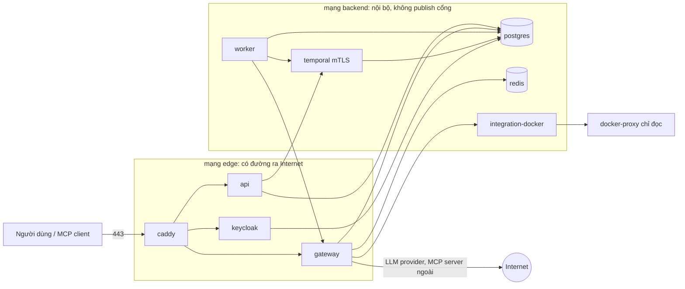

# Runbook: triển khai platform trên một máy chủ bằng Docker Compose

Trạng thái: bản đầu · 2026-11-19 · quyết định ở [ADR-0017](../adr/0017-single-host-docker-compose-deployment.md)

Dùng cho staging và production: cùng file `deployments/production/compose.yaml`, khác file env. Phát triển cục bộ dùng `make up-all` (file compose khác, xem `CLAUDE.md`).

Chưa có số đo tải; cỡ máy chủ và trần bộ nhớ trong file env là điểm xuất phát, không phải khuyến nghị đã kiểm chứng.

## 1. Sơ đồ



`worker` chỉ nằm trên mạng `backend`: nó không có đường ra Internet. Chỉ `caddy` publish cổng (80, 443); console quản trị của Keycloak nghe ở loopback của máy chủ.

## 2. Chuẩn bị máy chủ (một lần)

1. Docker Engine và plugin Compose (Compose ≥ 2.20: file dùng `depends_on.required`).
2. Ba bản ghi DNS trỏ về máy chủ: ứng dụng (`HQ_APP_DOMAIN`), MCP (`HQ_MCP_DOMAIN`), đăng nhập (`HQ_AUTH_DOMAIN`, nếu dùng Keycloak đi kèm). Mở cổng 80 và 443; không mở cổng nào khác ngoài SSH.
3. Lấy thư mục `deployments/production/` của repo về máy chủ (ví dụ `git clone` vào `/opt/hq`). Máy chủ không cần mã nguồn Go hay Node.
4. Tạo file env:

   ```sh
   sudo install -d -m 700 /etc/hq
   sudo install -m 600 /opt/hq/deployments/production/hq.env.example /etc/hq/hq.env
   ```

   Điền từng biến theo chú thích trong file. Khoá và mật khẩu: `openssl rand -hex 32`. Ba khoá `HQ_EXECUTION_TOKEN_KEY`, `HQ_SERVICE_TOKEN_KEY`, `HQ_SERVICE_SIGNING_KEY` phải khác nhau (process từ chối khởi động nếu trùng).
5. Khoá gốc của Secrets (**chỉ staging**; ở production provider cục bộ bị từ chối, [ADR-0012](../adr/0012-local-key-provider-before-cloud-kms.md)):

   ```sh
   docker run --rm --user 0 -v /etc/hq:/out <HQ_IMAGE>:<tag> /usr/local/bin/hqadmin secrets init -out /out/root.key
   sudo chown 65532:65532 /etc/hq/root.key        # uid của gateway trong container; file giữ quyền 600
   ```

   Lệnh in `HQ_SECRETS_PUBLIC_KEY=…`: chép vào file env, cùng `HQ_SECRETS_ROOT_KEY_FILE=/etc/hq/root.key`. Mất file này là mất mọi secret đã lưu: sao lưu nó tách khỏi bản sao lưu database.
6. Đăng nhập registry nếu image không công khai: `docker login ghcr.io`.

Kiểm cấu hình trước khi chạy gì: `deployments/production/bin/hqctl check`.

## 3. Triển khai và cập nhật

Image do workflow `release` của CI build và đẩy với tag là commit SHA (và `vX.Y.Z`).

```sh
hqctl deploy <tag>
```

Một lệnh làm cả lần đầu lẫn các lần sau: kéo image, chạy `migrate up`, đặt lại tài khoản database (`db-init`), rồi đổi `worker` → `gateway` → `api`, mỗi bước chờ healthcheck của bước trước. Bước nào hỏng thì các bước sau giữ nguyên bản cũ và lệnh thoát mã khác 0.

- Lần đầu còn có: cấp chứng chỉ nội bộ của Temporal, tạo schema Temporal, tạo namespace và search attribute `OrgId` / `ProjectId`, import realm `hq` của Keycloak, xin chứng chỉ TLS cho các tên miền.
- Mỗi lần cập nhật có vài giây `api` và `gateway` không trả lời (một replica). Execution đang chạy tiếp tục sau khi `worker` mới lên.
- **Lùi lại:** `hqctl deploy <tag trước>`. Migration chỉ tiến; thay đổi schema phá tương thích phải đi theo expand → contract qua ít nhất hai lần triển khai (`.claude/rules/database.md`), nếu không bản cũ không chạy được trên schema mới.
- Trạng thái: `hqctl status`. Log: `hqctl logs [service…]`.
- Chỉ cập nhật ứng dụng thì PostgreSQL, Redis, Temporal, Keycloak và Caddy không bị khởi động lại. Chúng chỉ đổi khi phiên bản hoặc cấu hình của chính chúng đổi.
- Máy chủ không tới được registry: nạp image bằng `docker load` rồi `HQ_SKIP_PULL=1 hqctl deploy <tag>`.
- Khác biệt riêng của một máy chủ (ví dụ thêm một managed MCP server) đặt ở `/etc/hq/compose.override.yaml`; `hqctl` tự nạp nếu file tồn tại.

## 4. Sau lần triển khai đầu

1. **Keycloak.** Mở tunnel `ssh -L 8180:127.0.0.1:8180 <máy chủ>`, vào `http://localhost:8180`, đăng nhập bằng `HQ_KEYCLOAK_ADMIN_USER` / `HQ_KEYCLOAK_ADMIN_PASSWORD`. Tạo tài khoản quản trị thật rồi xoá tài khoản khởi tạo; tạo user đầu tiên của platform trong realm `hq` và ghi lại `id` của user đó (là `sub` trong token).
2. **Organization đầu tiên:**

   ```sh
   hqctl admin org create -slug <slug> -name "<tên>" \
     -admin-issuer https://<HQ_AUTH_DOMAIN>/realms/hq -admin-subject <sub> -admin-email <email>
   ```

   Lệnh in `id` của organization. Đăng nhập thử ở `https://<HQ_APP_DOMAIN>/ui/`.
3. **Integration Docker** (nếu dùng): đặt `HQ_DOCKER_ORG_ID=<id organization>` và thêm `integration-docker` vào `COMPOSE_PROFILES`, `hqctl deploy <tag đang chạy>`, rồi:

   ```sh
   hqctl admin mcp-server register -slug docker -name "Docker" -org <slug> -endpoint http://integration-docker:8090/mcp
   ```

4. **Lịch của máy chủ** (cron của root; `hqadmin maintenance run` vẫn đặt lịch tay, xem `CLAUDE.md`):

   ```cron
   15 2 * * *  /opt/hq/deployments/production/bin/hqctl backup       >> /var/log/hq-backup.log 2>&1
   45 2 * * 0  /opt/hq/deployments/production/bin/hqctl maintenance  >> /var/log/hq-maintenance.log 2>&1
   ```

## 5. Sao lưu và khôi phục

`hqctl backup` ghi vào `HQ_BACKUP_DIR` một thư mục theo giờ UTC: `globals.sql` (role) và một file `pg_dump -Fc` cho mỗi database (`hq`, `keycloak`, `temporal`, `temporal_visibility`). Thư mục còn đuôi `.partial` là bản dở, không dùng.

- Bản sao lưu nằm **cùng máy chủ**: chép `HQ_BACKUP_DIR` ra nơi khác theo lịch thì mới chịu được mất máy. File chứa hash mật khẩu của role và toàn bộ dữ liệu tenant: mã hoá khi chép đi.
- Không nằm trong bản sao lưu database: `/etc/hq/hq.env`, `/etc/hq/root.key`, volume `hq_temporal-certs` (cấp lại được), volume `hq_caddy-data` (chứng chỉ, xin lại được).
- Khôi phục (trên máy mới, cụm đang dừng): chạy riêng PostgreSQL (`hqctl compose up -d postgres`), `psql -f globals.sql`, `pg_restore -C -d postgres <file>.dump` cho từng database, rồi `hqctl deploy <tag>`. Khôi phục `hq` mà không khôi phục `temporal` thì execution đang dở được đóng `timed_out` khi quá hạn.
- **Chưa diễn tập.** RPO / RTO chưa đo; đừng cam kết con số nào trước khi làm thử thật (roadmap Phase 6).

## 6. Thay thành phần đi kèm bằng dịch vụ ngoài

Bỏ profile khỏi `COMPOSE_PROFILES` trong file env, đặt biến tương ứng, `hqctl deploy <tag đang chạy>`.

| Thành phần | Bỏ profile | Đặt |
|---|---|---|
| PostgreSQL | `postgres` | `HQ_DB_HOST`, `HQ_DB_PORT`, `HQ_DB_NAME`, `HQ_DB_ADMIN_USER`, `HQ_DB_SSLMODE=verify-full`. Tài khoản quản trị phải tạo được role và database |
| Redis | `redis` | `HQ_REDIS_URL` (`rediss://…`) |
| Temporal | `temporal` | `HQ_TEMPORAL_ADDRESS`, `HQ_TEMPORAL_NAMESPACE`, `HQ_TEMPORAL_API_KEY`; bốn biến `HQ_TEMPORAL_TLS_CA_FILE` / `_CERT_FILE` / `_KEY_FILE` / `_SERVER_NAME` đặt rỗng; tạo search attribute `OrgId`, `ProjectId` (Keyword) trong namespace |
| Keycloak | `idp` | `HQ_OIDC_ISSUER` của IdP, `HQ_AUTH_DOMAIN` để trống; IdP phải phát token mang `aud` đúng `HQ_OIDC_AUDIENCE` / `HQ_GATEWAY_OIDC_AUDIENCE` |

## 7. Sự cố thường gặp

| Triệu chứng | Kiểm |
|---|---|
| `hqctl deploy` dừng ở `migrate` | `hqctl logs migrate`. Migration lỗi thì không process nào được đổi; sửa rồi triển khai lại |
| `api` / `gateway` khởi động lại liên tục ngay sau lần đầu | Thường là IdP chưa trả lời (Keycloak đang khởi động, hoặc Caddy chưa có chứng chỉ cho `HQ_AUTH_DOMAIN`). Hai process này từ chối chạy khi không đọc được khoá của IdP; chúng tự lên khi IdP sẵn sàng |
| `gateway`: "file khoá gốc phải chỉ chủ sở hữu đọc được" | `root.key` phải có quyền 600 và thuộc uid 65532 (hoặc `HQ_GATEWAY_UID`) |
| `gateway` không lên ở `HQ_ENV=production` | Provider khoá cục bộ bị từ chối: để trống `HQ_SECRETS_ROOT_KEY_FILE` và `HQ_SECRETS_PUBLIC_KEY` cho tới khi có Cloud KMS |
| `worker` / `api`: lỗi chứng chỉ khi nối Temporal | `hqctl compose run --rm temporal-certs` in tình trạng chứng chỉ. CA hết hạn (10 năm) phải đổi tay: dừng cụm, xoá volume `hq_temporal-certs`, triển khai lại |
| Caddy không xin được chứng chỉ | DNS chưa trỏ về máy chủ hoặc cổng 80 / 443 bị chặn: `hqctl logs caddy` |
| Đĩa đầy | Log container đã có trần (20 MB × 5 mỗi container). Kiểm `HQ_BACKUP_DIR` và volume `hq_pgdata`; phân vùng cũ dọn theo retention (`schema.md`) |

## 8. Chưa có

Metrics và cảnh báo; diễn tập khôi phục; chép bản sao lưu ra ngoài máy tự động; ký image và SBOM; triển khai không gián đoạn; giới hạn tốc độ ở cửa vào; các integration khác ngoài Docker trong file compose (chạy theo runbook riêng của từng integration); tách quyền Temporal theo process. Nâng phiên bản Temporal: đổi `HQ_TEMPORAL_VERSION`, đọc ghi chú phát hành của Temporal trước (chỉ nâng từng bản minor một), chưa có quy trình đã thử.
